# Scouts Electronics Activity Badge Booklet

**For Leaders:** Use the companion [Leaders’ Guide](Leaders%20Guide.md) for session planning, safety preparation, and advanced-topic notes.

## How to earn your badge

- Identify several common electronic components that are shown to you.
- Explain, in simple terms, the functions they perform in electronic circuits.
- Describe the systems used for marking components with their values
- Demonstrate by identifying the values of resistors and capacitors by their markings. Explain the importance of the rating of a component.
- Show that you know the symbols used to represent common components in circuit diagrams.
- Show how to identify the polarity of a diode and a specific PIN on an integrated circuit.
- Show that you’re aware of the safe working practices to be followed when handling electronic components, circuit boards and when soldering.
- Use a multimeter to measure voltage, current and resistance in a simple circuit.
- Explain the relationship between these values.
- Talk about the main differences in the operation of digital and analogue circuits.
- Construct three simple circuits.
- One of these should be based mainly on digital electronics. They can be from a book or magazine, or you can design the circuits yourself. If possible, at least one of the circuits should be soldered using either stripboard or a custom-made printed circuit board.
- Explain the principles behind the operation of each circuit and the typical values of voltage and current found in each.
- Explain the possible uses of the three circuits you built.
- Talk about the uses and benefits of electronics in everyday life.
- Explain how electronics can be used to improve lives.
## History and Introduction

Electronics uses electrical signals to make useful things happen. Those signals involve voltage and current, which are explained in this section. Today, electronics is a fast-changing field. The rapid growth of electronics started in the early 20th century when valves, also called vacuum tubes, were used to amplify electronic signals. Transistors and integrated circuits later made it possible to build smaller, lower-power electronic systems.

Electronics changed even more dramatically in 1948 when the transistor, a small, low-powered, solid-state electronic device, was invented. Transistors are smaller than vacuum tubes, require less power to function, and are more reliable. The development of the integrated circuit, or IC, advanced this technology further. ICs can contain tens of thousands of tiny transistors built onto a small piece of conducting material. This allows for the construction and production of complex electronic circuits, which are more efficient than tubes in processing electronic signals. ICs are used in many products today, including computers, audio equipment, cell phones, appliances, and automobiles.

## How to Earn the Electronics Scout Badge

## Tools for Electronics Work

The basic tools you will need for most of your electronics work are shown here. You can probably find some around your home and get others at an electronics parts store.

Some Basic Tools

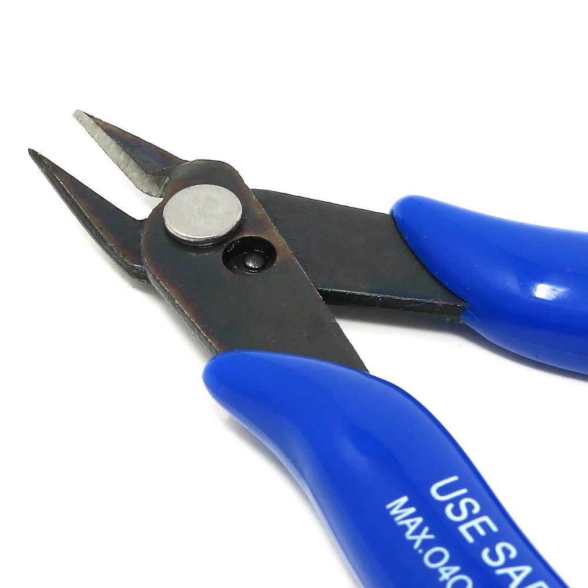

[https://thepihut.com/products/precision-diagonal-cutters](https://thepihut.com/products/precision-diagonal-cutters)

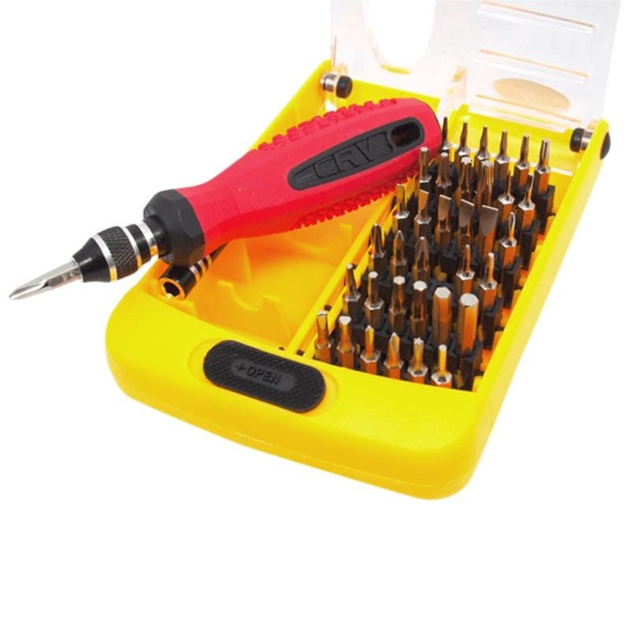https://thepihut.com/products/38-in-1-interchangeable-precise-tool-set

[https://amzn.to/4a0yyuT](https://amzn.to/4a0yyuT)

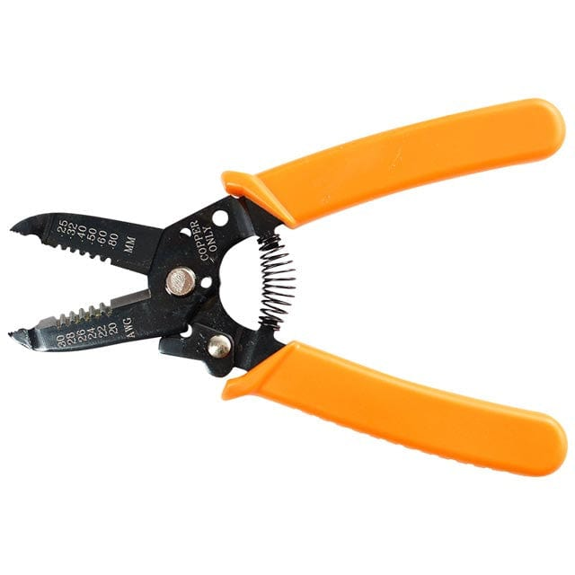

https://thepihut.com/products/wire-strippers

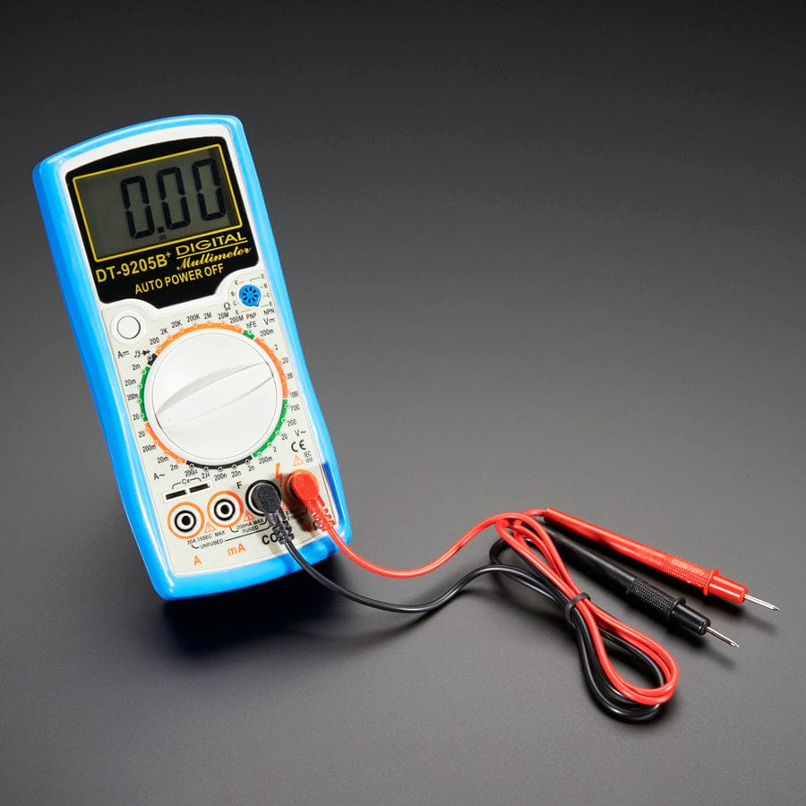

[https://thepihut.com/products/digital-multimeter-model-9205b](https://thepihut.com/products/digital-multimeter-model-9205b)

For most projects, you can use any small-diameter solid or stranded hookup wire. Some projects might also require very small wire. A magnifier or magnifying work lamp is recommended for examining the circuit board to check solder connections. Most electronics parts stores have a selection of perforated circuit boards made specially for wiring electronics projects. Many come with small clips for mounting parts. These boards are ideal for building simple circuits. You also will need an electric soldering iron, which you

can buy at a hobby, electronics parts, or hardware store.

Kitronik lists two soldering tool bundles:

- The [Soldering Iron Starter Kit](https://kitronik.co.uk/products/26104-soldering-starter-kit) contains a 30 W iron, safety stand, desoldering pump, and lead-free solder. Kitronik’s product Q&A says it does not stock replacement tips for this iron, so check tip availability before buying.
- The [Soldering and Electronics Tool Kit](https://kitronik.co.uk/products/26103-12-piece-electronic-soldering-and-repair-kit) adds a spare tip, pliers, screwdriver, voltage tester, and multimeter to a 30 W iron, holder, pump, and lead-free solder.

Both irons use a UK 230 V mains plug. Use them only with Leader supervision and follow the safety guidance in this chapter. Safety glasses and solder-fume extraction are not listed with either kit; arrange these separately. Check the product listings before ordering in case their contents change.

The soldering iron in a beginner’s tool kit should be a 15- to 40-watt iron with a fine chisel tip. Use a lead-free solder, like [https://amzn.to/4t8N10K](https://amzn.to/4t8N10K). Most of the solder you will need will have a diameter of about 0.8 mm.

Solder wick, also called solder braid, absorbs molten solder when you place it over a joint and heat it. It is useful for removing excess solder or cleaning a joint during rework. Kitronik lists a [1.5 m reel of solder wick](https://kitronik.co.uk/products/2645-economy-solder-mop) with a 2.5 mm braid width. Use it with a Leader, because the braid becomes hot during use.

Use a workbench for your project if you have one. If not, you can use a kitchen table, desk, or sturdy card table. You will need to have good light and ventilation and access to power outlets. You also will need a few small boxes, trays, or jars to hold parts.

## Buying Parts

Most electronics parts stores will have the components you will need for your project. If you do a project from scratch, you will have to buy the parts separately. While you also can buy a complete project as a kit, many electronics kits found in retail stores are not soldering kits, and building a project from scratch is challenging and rewarding. Scratch projects can be inexpensive if you can scrounge for most of the parts.

However, a kit has several advantages. All the necessary assembly instructions and parts are supplied, including wire and solder. Special parts, such as printed circuit boards, come with the kit. In addition, fewer tools are required because all necessary holes are pre-drilled. Since the kit has been carefully tested, you know that the finished product will work. A complete kit generally costs less than buying the parts separately. Investigate doing a project both ways before you invest your money.

For electronic parts and kits, you and your Leader could look at [Kitronik](https://kitronik.co.uk/), which sells educational electronics kits and project parts. [Pimoroni](https://shop.pimoroni.com/) and [The Pi Hut](https://thepihut.com/) are other UK options. [SparkFun](https://www.sparkfun.com/) is another supplier I recommend, but it is based in the United States. If ordering from the UK, check delivery and any extra charges first. Ask your Leader to check that the parts match the project list before ordering.

## Basic Electronics Theory

Before you learn about electronic components, let’s look at the ideas behind electronics. We will start with atoms and electrical charge, then see how charge moves in a circuit.

### Atoms and Electrons

Matter is made from atoms. A simple model shows each atom with a tiny nucleus made of protons and neutrons, and electrons around it. This picture is useful for learning, but electrons do not move around the nucleus like tiny planets. Protons have positive electrical charge, electrons have negative charge, and neutrons have no charge.

In a neutral atom, the positive and negative charges balance. Like charges repel; opposite charges attract.

### Electrical Charge

The amount of electrical charge is measured in coulombs (C). Rubbing two materials, such as a balloon and a woollen jumper, can transfer electrons from one material to the other. The material that gains electrons becomes negatively charged; the material that loses them becomes positively charged. Rubbing moves charge; it does not create charge. A build-up of charge like this is called static electricity.

#### Activity: make a balloon stick

**You will need:** a balloon, a woollen jumper or piece of wool fabric, a smooth wall, and (optionally) a few small pieces of paper. Use a non-latex balloon if anyone taking part has a latex allergy.

1. Rub the balloon on the wool fabric several times.
2. Hold the balloon close to the wall without pressing it against the wall. Observe what happens.
3. Bring the balloon near the paper pieces. Observe whether they move.
4. Repeat the tests without rubbing the balloon first, then compare the results. Try different fabrics and record what you observe; the result can vary with the materials and the conditions.

**What is happening?** Rubbing brings the materials into close contact. With a rubber balloon and wool, electrons commonly transfer from the wool to the balloon, although the result can vary with the exact materials. The balloon gains negative charge and the wool is left positively charged. Opposite charges attract. The wall can still be neutral overall: the balloon makes the charges in atoms near its surface shift slightly, leaving the nearby area a little more positive. This attraction can make the balloon stick. Charge gradually leaks away, and the effect may be weaker in damp air.

**Safety:** Keep the balloon away from exposed electronic components, which can be damaged by static discharge. Do not deliberately make sparks or do the activity near flammable vapours.

When charge moves through a circuit, we call that movement an electric current. Throughout this booklet, current follows the conventional direction: from positive to negative around the external circuit. Use this direction in circuit diagrams and calculations.

**Advanced note:** Conventional current is a direction convention, not the direction that electrons drift in a metal wire. In metal wires, electrons drift from negative to positive. Conventional current remains the standard direction used in circuit diagrams and formulae.

### Conductors and Insulators

Conductivity describes how easily electrical charge moves through a material. Metals such as copper conduct well because some electrons can move through them. Materials such as plastic, rubber, and glass resist the movement of charge and are called insulators. Conductivity is not simply on or off: materials conduct by different amounts, and conditions such as temperature can affect them. In an insulated wire, the copper core carries current while the plastic covering helps prevent the core from touching other conductors by accident.

### Circuit basics

A simple circuit has a source, a load, and a conducting path that connects them in a loop. A battery is a source; a lamp or resistor is a load; wires provide the path. The battery's voltage drives conventional current around the complete loop. The lamp changes some electrical energy into light and heat, but the charge continues around the circuit.

When a switch opens the loop, the circuit is open and current stops. If the battery remains connected, there can still be a voltage across the open switch. Closing the switch completes the path again and allows current to flow.

A short circuit is an unintended low-resistance path that bypasses the load. It can allow excessive current to flow and heat the wire or battery. Never connect a wire straight across a battery's terminals.

### Current, Voltage, and Resistance

Here are some basic definitions of terms used in electronics.

- Current is the rate at which electrical charge passes a point in a circuit. It is measured in amperes (A). One ampere means one coulomb of charge passes each second. In a simple series circuit, the same current flows through every component.
- Voltage is the difference in electrical potential between two points. It tells us how much energy is transferred for each coulomb of charge that moves between them, and it is measured in volts (V). Chemical reactions in a battery create a potential difference between its terminals. For example, a 9 V battery has a nominal potential difference of 9 V between its positive and negative terminals.
- The opposition to current flow is resistance. The resistance of a material is mainly determined by how many free electrons it has. If the material doesn’t have many, it will have little or no current flow. The unit of resistance is the ohm. One ohm is the amount of resistance that will allow 1 ampere of current to flow when the applied voltage is 1 volt.

The water analogy can help: voltage is like a pressure difference that can drive flow, but it is only an analogy. Voltage is measured between two points. A circuit diagram may mark one point as 0 V, common, or ground so other voltages have a reference. In a battery-powered circuit, this is a chosen reference and is not necessarily connected to the Earth.
### Frequency

Frequency tells us how many times a repeating signal completes a cycle each second. It is measured in hertz (Hz). The UK electricity network has a nominal frequency of 50 Hz. The battery-powered circuits in this booklet use DC, not mains electricity. See the [National Energy System Operator's explanation of frequency](https://www.neso.energy/energy-101/electricity-explained/how-do-we-balance-grid/what-frequency).

### Ohm’s Law

Ohm’s law describes the basic relationships between current, voltage, and resistance. The formula for Ohm’s law is:

Voltage (volts) = Current (amperes) &#215; Resistance (ohms)

To determine current, the formula would be:

Current (mps) = Voltage (volts) &#247; Resistance (ohms)

If you know current and resistance, you can find out the voltage. For example, how much voltage is needed to force 2 amperes of current to flow through 10 ohms of resistance?

Ohm’s law tells us that we need to multiply our 2 amperes. (current) by the 10 ohms (resistance) to arrive at the answer: 20 volts.

If you know voltage and resistance, you can figure out current (Voltage &#247; Resistance). Therefore, how much current will flow in a circuit having 5 ohms of resistance when 15 volts are applied?

15 volts &#247; 5 ohms = 3 amperes

With these formulas, you can solve simple problems involving current, voltage, and resistance.

## Power

Electrical energy can be changed into other forms, such as light, heat, sound, or movement. A battery transfers energy from its chemical store into a circuit; an LED changes some of that electrical energy into light and heat, while a motor changes some into movement. Energy is measured in joules (J).

Power tells us how quickly energy is transferred or changed. One watt (W) is one joule of energy transferred each second. For a component, calculate power using the voltage across it and the current through it:

Power (watts) = Voltage (volts) &#215; Current (amperes)

For example, if a checked low-voltage circuit has 5 V across a component and 0.1 A flowing through it, the power is 0.5 W. A higher power means energy is transferred more quickly. Check a component's power rating as well as its voltage and current limits.

### SI prefixes

SI prefixes make very large and very small values easier to write and read. The prefix goes before a unit and tells you how many times larger or smaller the value is.

| Prefix | Symbol | Meaning | Example |
|---|---:|---:|---|
| kilo | k | 1,000 times | 1 kΩ = 1,000 Ω |
| mega | M | 1,000,000 times | 1 MΩ = 1,000,000 Ω |
| giga | G | 1,000,000,000 times | 1 GΩ = 1,000,000,000 Ω |
| milli | m | one thousandth | 1 mA = 0.001 A |
| micro | μ | one millionth | 1 μF = 0.000001 F |
| nano | n | one billionth | 1 nF = 0.000000001 F |
| pico | p | one trillionth | 1 pF = 0.000000000001 F |

The capital and lower-case letters matter: `M` means mega, but `m` means milli. For example, `42 mA` is `0.042 A`, and `24 kΩ` is `24,000 Ω`. A prefix can be used with different units, such as volts, amperes, ohms, and farads. Use the prefix that makes a value easy to read.

### Current Delivery

Electrical signals are classified as direct current (DC) or alternating current (AC). DC keeps the same polarity, although its voltage can stay steady or vary. AC changes polarity repeatedly; its voltage may follow a sine wave or another repeating pattern. The number of cycles per second is its frequency.

### Resistance and Resistors

You have learned that when you apply a voltage to the ends of a conductor, it creates a current. Its strength depends on the applied voltage and the resistance of the conductor. The resistance of a conducting material depends on three factors:

- The kind of material
- The length of the material
- The diameter or thickness of the material
Temperature also is a factor in resistance. In most materials, resistance is increased when the temperature rises and decreased if the temperature is colder. In most simple circuits, however, temperature is not critical and is often ignored. The kind of material is probably the most important factor in resistance. Copper, for example, is a good conductor, while iron of a similar size has a higher resistance. Carbon has even a higher resistance than iron.

The longer the conductor, the higher the resistance will be. For instance, if the length of a copper wire is doubled, the resistance will be doubled. As an example, a 60-foot length of copper wire might have a resistance of 1 ohm. A same-sized copper wire that is 120 feet long would have a resistance of 2 ohms.

Size is important, too. A thick conductor will carry more current and offer less resistance than a thin one. Think again of water pipes. A large water pipe will allow more water to flow than a small one. When a current flows through a resistor, a component that limits or opposes the flow of a current, work is being done to move the electrons. This work produces heat and warms the resistor. Heat produced by an electric current is the basis for the operation of many electrical devices and appliances such as heaters, toasters, stoves, and soldering irons. In a lightbulb, an electrical current causes a wire filament to become so hot that it glows to produce light. Only a fraction of the power that comes from the filament produces light.

The rest generates heat, which is why incandescent bulbs are so inefficient. A resistor is designed to have a specific value of resistance, and resistors are available in a wide range of values. Standard power sizes are 1/4-watt, 1/2-watt, 1 watt, and 2 watts. These values indicate the maximum recommended power that the resistor can dissipate. The higher the power rating, the larger the resistor.

Capacitors and Capacitance

A capacitor stores energy in an electric field between conducting parts separated by an insulator. In a simple capacitor, the two conducting plates gain equal and opposite charges when the capacitor is connected to a battery. Charge does not pass through the insulating layer between the plates. When the battery is removed, the capacitor can release its stored energy into a circuit. Real capacitors slowly lose charge through leakage.

The amount of charge stored for a given voltage is described by capacitance, measured in farads (F). A farad is a large unit, so practical capacitors are commonly marked in microfarads (µF) or picofarads (pF). Capacitors can use insulating materials such as ceramic, mica, paper, air, or oxide. Electrolytic capacitors have positive and negative leads and must be connected with the correct polarity.

### Valves (Vacuum Tubes)

Before transistors and integrated circuits became common, electronic equipment often used valves, also called vacuum tubes. Valves could amplify signals and act as switches, helping make early radio, television, radar, and other electronic systems possible. They were generally larger, hotter, more fragile, and less energy-efficient than transistors, so most modern electronics uses semiconductor devices instead. Valves are still found in some specialist equipment and musical-instrument amplifiers.

### Semiconductors

The word semiconductor is used to name a wide variety of electronic devices. Made of solid or liquid material, semi-conductors generally can conduct electricity more easily than an insulator, but not as easily as a metal. The semiconductor diode performs the same basic function as the electron-tube diode. It allows current to flow in one direction, but not the other. This diode consists of two different types of silicon crystals. An impurity (some type of substance) can be added to one area of the silicon to control the silicon’s conductivity. The silicon is said to have been “doped” when it has been treated with atoms from an impurity. These atoms combine with the silicon atoms in such a way that electrons float around freely inside the silicon. This type of silicon is called N-type (or negative-type). The N-type silicon is the cathode of the diode.

The other area of silicon also has an added impurity. But the atoms of this impurity combine with the silicon atoms in such a way that there is a shortage of one electron in the bonding. The absence of an electron is called a “hole,” and this hole can grab an electron from a neighbouring atom. Thus, a hole can “float” from atom to atom the same way an electron might. The silicon with the holes is called P-type (positive).

For conventional current to flow through a forward-biased diode, the anode connects to the positive side of the supply and the cathode to the negative side. A reverse-biased diode normally allows only a very small leakage current, unless its breakdown rating is exceeded.

In a suitable NPN transistor circuit, a small current into the base controls a larger conventional current from the collector to the emitter. Reducing or removing the base current reduces or stops the collector current. A PNP transistor uses opposite polarities and current directions. Follow the circuit diagram and the transistor’s datasheet for its connections and limits.

Notice the symbol in the illustration used to represent the NPN transistor. Another type of transistor is called the PNP transistor. Its structure and schematic symbol are shown in the following illustration. This transistor requires opposite polarity voltages for proper operation.

NPN and PNP transistors are called bipolar transistors, and they are the most popular types used.

### Field Effect Transistor

The field effect transistor uses a single N-channel or P-channel with an insulated metal plate used to control current flow. Current enters the channel at the source lead and flows toward the drain lead at the other end of the channel. The voltage applied to the insulated plate, known as the gate, limits the current flow through the channel from source to drain. The most used FET is the metal-oxide semiconductor FET or MOSFET. An N-channel MOSFET will not conduct current if there is no voltage difference source to gate and allow current flow when a higher voltage is applied to the gate (voltage difference with respect to the source pin). A P-channel MOSFET will conduct current if there is no voltage difference source to gate and allow current flow when a lower voltage is applied to the gate (voltage difference with respect to the source pin).

Complementary MOS or CMOS technologies use one P-channel MOSFET and one N-channel MOSFET connected such that the P-channel source pin connects to the circuit higher voltage (typically power supply) and connects the N-channel source to the lower voltage supply (typically 0-volt or ground). The drain of the two MOSFETs are connected and is the circuit output. The gates are tied together. When the gates are connected to a low voltage (ground), the source to gate voltage of the N-channel is 0 volts so the channel transistor is “off” while the gate to source voltage of the P-channel FET is the “hi” voltage, so that transistor is “on” meaning the output voltage is connected to the power supply or high (for a low input). Conversely, if the two gates are tied to the higher voltage, the N-channel gate to source is now high, so it is “on” while the P-channel transistor gate to source is voltage is low, so it is “off.”

### Integrated Circuits

An integrated circuit (IC) is a complete circuit in a single package. Transistors, resistors, diodes, and capacitors can be formed in a single chip of silicon, a semiconductor. One chip can contain thousands or even millions of electronic components. Integrated circuits have revolutionized many fields, including communications, information handling, and computing. They have reduced the size of devices, while providing faster speeds and increased reliability. The individual components of ICs are extremely small and are assembled to a pattern that has been planned. A chip might look flat, but it has several layers for circuits. Switches control the electrical current through the chip. The switches manipulate the binary code (discussed below) with “on” and “off” switches. The binary code is at the core of how a computer operates.

Chips come in many different sizes, with millions of transistors being able to fit on chips the size of a postage stamp. Two basic types of IC are called linear and digital. Linear circuits include amplifiers, oscillators, regulators, and other circuits used in TV sets, audio amplifiers, radios, and hearing aids. Digital circuits include memories and arithmetic circuits and counters in watches, calculators, computers, and video games.

### Microprocessors

The microprocessor is a type of ultra-large IC. By 1971, the technique of making ICs had progressed to the point where enough computing power could be put on a single IC to form a tiny, primitive computer, or calculator. The first microprocessor was born. Today, microprocessors can incorporate more than a billion transistors, plus components such as resistors, capacitors, diodes, and wires. The microprocessor accepts input data, modifies that data in some way, and produces an appropriate output. The earliest application of the microprocessor was the calculator. A calculator accepts numbers that the user enters on a keyboard, performs a mathematical operation on those numbers that the user desires, and then sends the result to a display.

Today’s microprocessors function as the central processing unit (CPU) of computers. They also are used in many electronics systems such as cameras, printers, planes, and automobiles. The microprocessor in an automobile, for instance, examines inputs from several sensors, makes decisions based on those inputs, and adjusts such things as the mixture of air and fuel and the timing of ignition firing. The microprocessor’s most important aspect is that it can be programmed to perform an almost limitless number of applications.

### Printed Circuit Boards

A printed circuit board (PCB) consists of a sheet of some type of insulator, a composite material classified as FR-4 made of woven fiberglass cloth with an epoxy resin binder. The FR-4 material is an insulator with copper traces printed or etched onto the FR-4 surface. The copper traces are implementations of the wire lines of the schematic drawing. Parts of traces may need to be routed from one side (layer) to the other side (layer). To connect the traces, feed-through holes are added to the circuit board. Feed-through holes are drilled through the printed circuit board then filled with solder. The solder connects the copper of the top, bottom, and optional intermediate layers. Feedthrough hole’s solder is done during the fabrication of the circuit board.

Optionally, feed-through holes can be used to hold component leads. The feed through has a hole drilled through the solder for the component lead. The drilled hole is done during fabrication of the printed circuit board. The completed printed circuit board is now ready for insertion of the components drawn in the schematic.

A feed-through hole used for a component lead must be larger to allow room for the component lead diameter plus some insertion clearance of the lead into the hole. If no component lead is being inserted in the hole, the diameter of the feed-through hole can be much smaller and require less printed circuit board space. Later, during the assembly process, a component lead is inserted into the hole and the hole and lead must be soldered together to make solid electrical contact. Several layers of traces, separated by FR-4 sheets may be sandwiched together for more complex electronic designs with feed-through holes connecting the traces as needed.

### Through-Hole Technology

The technology used for placing component leads in holes drilled through the printed circuit board reached a practical limit when integrated circuits got over about 40 pins. A feed-through hole with space for the lead and the insertion tolerance meant that, based on PCB fabrication technologies at the time, integrated circuit leads needed to be about 0.100&quot; apart. Various techniques were tried with larger IC packages including longer packages, the IC pins in a grid pattern and others. There was not a viable solution to reach what would eventually be today’s package pin counts.

### Surface-Mount Technology

By removing the component pin from going through the feed-through hole, the feed-through could be much smaller and moved away from the component. The component pins could be replaced with a square pad on the component, and the printed circuit board would have a matching pad on the “out-side” copper layer. Without the constraint of the feed-through hole with drilled lead space, component pins could be placed much closer together or more pins could be placed around the former through hole package sizes. This change led to the very high pin count packages required for today’s integrated circuits, such as the processor of your home computer.

### Schematic Diagrams

Schematic diagrams show how electronic components are connected. They use symbols for components and lines for wires, rather than pictures of the parts. This booklet follows IEC-style symbols used in UK diagrams. For example, a resistor is shown as a rectangle, and a battery is shown with long and short lines.

Some North American schematics, often called ANSI/IEEE style, use a zigzag line for a resistor instead of a rectangle. Both symbols represent a resistor. When you meet a diagram that uses unfamiliar symbols, look for its key or legend and follow the connections shown. In many diagrams, a dot marks wires that join at a crossing; check the diagram’s own convention if it is not clear.

When you draw a schematic, use one symbol style consistently and include a key if you use symbols that may be unfamiliar. You can draw it with a pencil, paper, and a ruler, or use a schematic-capture program such as KiCad.

### Quick check: electrical fundamentals

**Question 1 of 11**

Voltage is the difference in electrical potential between `_____`.

- Scarves and balloons
- Any two points
- Protons and electrons
- Conductors and insulators

**Answer for the Leader:** Any two points. Voltage is a difference in electrical potential between two points.

**Question 2 of 11 — advanced trick question**

This question is about electron drift in metal wires, not the conventional-current direction used in circuit diagrams.

Electrons flow from the positive battery terminal towards the negative terminal.

- False
- True

**Answer for the Leader:** False. In the external wires of a simple battery circuit, electrons drift from the negative terminal towards the positive terminal. Conventional current is described in the opposite direction, from positive to negative.

**Question 3 of 11**

Which material is the best electrical conductor?

- Copper
- Glass
- Rubber
- Plastic

**Answer for the Leader:** Copper.

**Question 4 of 11**

When there is an imbalance of charge between two objects, it creates a `_____` between them.

- Resistance
- Power
- Voltage
- Current

**Answer for the Leader:** Voltage.

**Question 5 of 11**

In a metal wire, the negatively charged particles that move are called `_____`.

- Atoms
- Protons
- Electrons
- Neutrons

**Answer for the Leader:** Electrons.

**Question 6 of 11**

A lowercase letter `m` is the symbol for which SI prefix?

- Milli
- Micro
- Nano
- Mega

**Answer for the Leader:** Milli. Micro uses `μ`, nano uses `n`, and mega uses uppercase `M`.

**Question 7 of 11**

Electrons move freely through insulating materials.

- False
- True

**Answer for the Leader:** False. Insulating materials resist the movement of electrical charge; they do not normally let charge move freely like a conductor.

**Question 8 of 11**

Which option is **not** a basic element of an electrical circuit?

- Conductive pathway
- Voltage source
- On/off switch
- Electric load

**Answer for the Leader:** On/off switch. A basic circuit needs a source, a load, and a conducting path. A switch can control the path, but it is optional.

**Question 9 of 11**

For a fixed resistor, if the voltage across it increases, what must happen for the current through it to remain constant?

- Increase the resistor’s resistance.
- Remove the resistor from the circuit.
- Increase the resistor’s conductivity.
- Decrease the resistor’s resistance.

**Answer for the Leader:** Increase the resistance. From Ohm’s law, `I = V ÷ R`; if the voltage increases while the current stays the same, the resistance must increase too.

**Question 10 of 11**

Which choice is a pair of particles with equal and opposite charges?

- Protons and electrons
- Neutrons and atoms
- Protons and neutrons
- Electrons and neutrons

**Answer for the Leader:** Protons and electrons. A proton has a positive charge and an electron has an equal-sized negative charge.

**Question 11 of 11**

Using conventional-current notation, electric current is shown flowing from the positive battery terminal towards the negative terminal.

- True
- False

**Answer for the Leader:** True. This is the conventional-current direction used in circuit diagrams and throughout this booklet.

## Component Types

Before we look at the most common types of electronics components, as well as the schematic symbol and a pictorial of each one, let’s define and review some basic terms (also see the Basic Electronics Theory section):

- Electricity is a property that electrons have that causes them to behave in certain predictable ways.
- Electrical charge is a quantity of electricity.
- The electron is a tiny particle that has a negative electrical charge.
- Current is defined as the flow of electrons.
- Voltage is the pressure that causes current to flow.
- Resistance is the opposition to current flow.
- Direct current (DC) is current that always flows in the same direction.
- Alternating current (AC) is a current that reverses its direction of flow many times each second.
- Frequency is the number of cycles a signal completes each second.
### Passive Components

#### Fixed Resistor

Each resistor has a specific amount of resistance. A resistor is like a nozzle on a water hose. For a given water pressure, the nozzle controls the amount of water that is allowed out of the hose. Similarly, for a given voltage, a resistor controls the flow of electrical current.

Most resistors are made of a carbon compound. Resistors used for high currents often are made from special wire that is wound on an insulating form. The type of compound or wire used determines how much electrical current can flow for a given voltage. The value of a resistor is given in ohms. The symbol for the ohm is the Greek capital letter omega (Ω). Thus, 1Ω designates the resistance of 1 ohm. A 1kΩ resistor has a resistance of 1 kilohm, or 1,000 ohms. A 1MΩ resistor has a resistance of 1 megohm, or 1 million ohms.

The illustration below shows a variety of fixed resistors and a cross-section of a fixed resistor. The values of fixed resistors cannot be changed.

Older types of fixed resistors have bands of colour that allow you to determine their resistance value. (See “The Colour Code of Resistors” section on page 40.) The cross-section of this fixed resistor shows the inside, which is made of carbon.

Note the schematic symbol for a fixed resistor.

#### Variable Resistor

The resistance of variable resistors can be adjusted. Rheostats are two-leaded devices that vary in resistance from 0 to the rated resistance value. Three leaded variable resistors, known as potentiometers (pots), have a fixed resistance between leads 1 and 3, and have a resistance on lead 2 proportional to the amount of rotation on the adjustment arm. These variable resistors can be used in appliances that need their currents adjusted or when the resistance needs to be varied, such as with lights that can be dimmed.

#### Capacitor

A capacitor is a storage element for electrical charge, like a bottle that stores a liquid. The basic unit of capacitance is the farad (F). Practical capacitors have capacitance values in microfarads (&#181;F). The physical size of a capacitor depends on its voltage rating and its capacitance value. The higher the voltage rating and the larger the capacitance value, the larger the capacitor must be.

#### Inductor

An inductor is a coil of wire usually wrapped around some type of metal or hollow core material and is used to smooth out variations in the current flow. When current is applied to the coil, a magnetic field is established around the core. When the current flow stops, the magnetic field begins to collapse and in doing so induces current back into the wire until the field has collapsed. The magnetic field tends to collapse at a rate that maintains the original current in the wire. Single coil configurations are generally called a choke whereas two or more coils can be configured either as a choke to filter current changes or as a transformer for changing voltage and current values.

#### Transformer

A transformer consists of two or more coils each with multiple turns of wire around the magnetic core. The primary coil is the coil where power is applied to the transformer, and the other coils are referred to as secondary coil(s). The transformer uses the magnetic field established by current flow in the primary coil to induce a current in the secondary coil(s). The ratio of turns from the primary to a secondary coil determines how much the incoming voltage is multiplied on the secondary side and how much the secondary current is divided by the primary current in the secondary. Because transformers operate on changing magnetic fields caused by changing current, transformers do not operate on direct current (DC) currents.

### Semiconductor Devices

Semiconductor devices are typically made of silicon-based material. Diodes and transistors are two common semiconductor component types. Semiconductors come in various package sizes based on the amount of power they must dissipate in rated operation.

#### Diodes

Diodes operate as check valves, passing current in one direction but not the other. A diode’s most common application is in power supplies. It changes alternating current (AC) into direct current (DC).

#### Light-emitting diodes (LEDs)

An LED is a diode that gives off light when current flows through it in the forward direction. Changing its forward current (`I_F`) changes its brightness: less current usually makes it dimmer, and more current usually makes it brighter. More current also makes the LED produce more heat. Too much heat can damage it and make it fail, so do not exceed the current rating in its datasheet. As a practical guide, 20 mA is a sensible upper design value for many common 3 mm and 5 mm indicator LEDs, but it is not a rating for every LED. Check the datasheet for the LED you are using; a lower current may give enough light while keeping it cooler.

A bare LED needs current limiting: in the simple circuits in this booklet, connect a suitable resistor in series with it. Do not connect a bare LED directly across a battery or an output pin, because too much current can damage the LED or the circuit. Some LED modules already contain a resistor or another current-limiting circuit, so check the module instructions before adding parts.

#### Transistors

Transistors are solid-state devices used for controlling current. A very small input current controls a much larger output current. For example, the small current from a microphone can control a much larger current that drives a loudspeaker. This is the idea behind the audio amplifiers used in public address systems.

#### Integrated Circuits (ICs)

Complex circuits are available in integrated circuit (IC) form at inexpensive prices. The IC, which typically consumes little power, is reliable, cheap, and small. Because devices using ICs can be improved and made cheaper, the IC has replaced traditional components in many applications. As shown here, ICs come in several types of packages. The dual in-line package (DIP) is the most popular style for most hobby applications.

Schematic symbols for ICs are typically very function specific.

### Electromechanical Components

#### Microphone:

A microphone changes sounds into electrical impulses. Either a thin, flexible disk (a diaphragm) or a crystal in the mike vibrates whenever sound strikes it. The vibrations are changed into small electrical signals. These signals typically need to be amplified before they are usable.

#### Speaker

A speaker then converts the electrical impulses back into sounds. An electromagnet moves a speaker cone based on the incoming audio signal. The speaker cone moves the air around and it which causes the audio sound to spread across the space and recreating the original sound.

#### Switches

Switches are an important part of almost all electronic equipment. They come in a wide variety of shapes, sizes, and functions. Switches are categorized by the number of circuits they switch (single, double, triple, etc.) and then by the number of switch position contacts. A switch may have an output contact for each position of the switch. The switch will typically have a default position. A circuit that makes contact in that position is called a Normally Closed (NC) contact or in drawing below from terminal A&#160;to&#160;C. If the switch is moved out of default position, and contacts an electrical terminal, that position is called Normally Open (NO) and is shown as connections A&#160;to&#160;B in drawings below).

The simplest is the single-pole, single-throw type. When closed, this switch completes a circuit, allowing an electric current to flow. When it is open, the circuit is broken, and the current does not flow. The on-off switches on most electronic devices are of this type (above left).

A single-pole, double-throw switch has a contact arm that can be set in either of two positions. In the example shown here, terminal A can be connected to either terminal B or terminal C. The dashed line between the switches shows the mechanical connection (above centre).

A double-pole, double-throw switch can simultaneously switch two wires from one circuit to another. It can be thought of as two single-pole, double-throw switches that operate together (above right).

A rotary or selector switch has one or more arms (poles) that can be set to various positions. A single pole 10-position switch is shown below. Notice that the terminal at the very bottom connects the signal to the rotatable arm.

#### Relays

A relay is a magnetically operated switch. It has a wire coil wrapped around an iron core forming an electromagnet. When current flows through the coil, a magnetic field develops. The magnetic field attracts a movable part called an armature, which moves all relay switch poles from normally Closed (magnet off) to Normally Open (magnet energized).

A relatively small current can cause the switch contacts to close, but the contacts can handle a much heavier current. The relay allows a small current to switch higher current(s) on or off. By using several contact sets (single, double, triple or more poles and single or double throw). A multi-pole relay allows a single control (coil) current to control several different currents simultaneously.

### Chemical Components

#### Batteries

Batteries are made from several types of materials for different uses. Alkaline, lithium, and mercury batteries are used when long life is desired. Nickel-cadmium batteries give shorter service but can be recharged. The nickel–metal hydride battery is replacing the nickel-cadmium battery because it doesn’t suffer the memory effect (that is, not allowing a partially charged battery to fully recharge before use). Lithium-Ion type batteries have replaced many of the older battery types. Zinc-carbon also is used in many inexpensive dry-cell batteries. Most electronic circuits and products operate at low supply voltages and have low power requirements. These devices are often driven from small batteries or DC voltage sources. Depending on the type of product, a coin battery, one, two or four flashlight batteries are often adequate for relatively long service.

Ordinary flashlight dry cells produce approximately 1.5 volts. Four 1.5-volt cells connected in a series can provide 6 volts. Single 9-volt batteries also are used.

#### Photocells

A photoelectrical cell changes one or more of its characteristics when exposed to light. It is popularly called the electric eye, which controls operations such as traffic lights, door openers, and devices that activate lights at dusk and turn them off at dawn. One type of photoelectric cell is called a photoconductive cell. Another name for this type of cell is the light-dependent resistor (LDR). This special resistor has a small window so that light can strike the resistance material. Generally, such a cell has a high resistance when in darkness. Another type is called a photovoltaic cell. This is the familiar “solar cell” that is used to power electronic equipment on spacecraft. It produces a low voltage across its terminals when exposed to light, especially sunlight, thus converting light energy into electrical energy.

### Other Component Types

There are many other types of components used in electronics, but these are the more common components that a hobbyist is likely to use.

## The Colour Code of Resistors

The value of a resistor is specified in ohms and is indicated by coloured bands around one end of the resistor. The electronics industry devised this system because small, printed numbers would be too hard to read or might be concealed by the position of the resistor.

Most resistors have four bands, with the first three (counting from the end of the resistor) indicating the value in ohms. The fourth, which is either silver or gold, indicates the tolerance (discussed below). colours used for the bands are used in place of numbers. To determine the resistance value in ohms, examine the colour bands starting with the one closest to the end of the resistor.

Suppose a resistor has a brown, a black, and then a brown band. The code chart shown here tells you that brown represents the number 1. The second black band represents the number 0. The third band tells you how many zeroes to add to the first two numbers. In the example, the band is brown, so you add one zero. Therefore, the value of this resistor is 1-0-0, or 100 ohms.

Now try the example for the resistor shown here, which has a red band first, then a yellow band, and then an orange band. The red band means that the first number is 2. The yellow band corresponds to the number 4. The orange band tells us to add three zeroes. Thus, the value is 2-4-000, which translates to 24,000 ohms, or 24 kilohms (kΩ).

Most surface mount components are too small for colour bands, so the colour bands are converted back to digits and printed onto the top of the resistor as 243 for 24,000 ohms, or 24 kilohms (kΩ).

## Soldering

Before you begin working with a circuit, read and study this chapter on soldering. Anyone working in electronics must know how to solder well, and safely. It takes practice, but once you learn, you will be able to properly assemble an electronics project. In all electronics work, the wiring connections must be secure. A loose connection in a radio, for example, could result in noise, scratching sounds, or no sounds at all. Poor connections in a TV could disrupt the sound and picture. And beyond just a radio and a TV in someone’s home, the safe operation of airplanes and the lives of astronauts in flight depend on secure electronics connections.

Soldering is not just gluing metals together. Done correctly, it creates a reliable electrical and mechanical connection between clean metal surfaces. Use the solder alloy and flux recommended for the equipment and project. Lead-free solder is preferred for beginner activities unless a Leader has approved another type.

### Set up a safe work environment when soldering

Work with a Leader supervising. Set up a tidy, stable bench with a heat-resistant surface and good lighting. Keep food, drinks, paper, and other things that can burn away from the work. Tie back long hair and secure loose sleeves. Arrange the soldering iron, its stand, and its cable so that nobody can knock or pull the hot iron off the bench.

Wear safety glasses while soldering and trimming component leads. Hot solder can spit, and a clipped lead can fly towards your eyes. Good lighting or a magnifier can help you see the joint, but neither replaces safety glasses.

Flux used for soldering can give off fumes when heated. Use a suitable solder-fume extractor set up by your Leader, keep your face out of the fume, and never overheat the iron. The Health and Safety Executive warns that fume from rosin-based solder flux can cause asthma and recommends fume extraction. Read the [HSE guidance for solderers](https://www.hse.gov.uk/asthma/solderers.htm).

Put the iron in its stand whenever you are not using it. Do not touch its metal tip, and treat the iron, solder, and board as hot until they have cooled. Do not leave a hot iron unattended. Ask your Leader to switch off and unplug it after the activity, and wait for it to cool before packing it away.

Some solder contains lead. Do not eat or drink at the workbench, and keep solder and clipped leads away from your mouth. Wash your hands with soap and water after soldering and before eating or drinking. See the [HSE guidance on lead and hand hygiene](https://www.hse.gov.uk/lead/mostatrisk.htm).

Some electronic components can be damaged by static electricity. Ask your Leader how to handle any parts that need protection from static.

### Basic hand tools for soldering

For a small through-hole project, a few hand tools make the work easier. Ask your Leader to show you how to use each tool.

- **Wire strippers** remove insulation from hookup wire. Use the slot that matches the wire size. Cutters can nick or break the wire underneath, so do not use them as a substitute for a wire stripper.
- **Flush side cutters** trim component leads after soldering. Their small, angled head can reach close to the board. Cut the lead just above the solder joint, without touching the board or joint. Wear safety glasses and point the cut end away from people; collect the offcuts.
- **Long-nose pliers** help bend component leads and hold wires in place before soldering. Do not handle a lead or joint until it has cooled.
- **Tweezers** can help position small components. They are useful for tiny parts, but not every project needs them. Metal tweezers can become hot if they touch the iron or a hot joint.

### Choosing a soldering iron

Ask your Leader to help choose an iron that suits the project. A temperature-controlled iron or station lets the Leader select a suitable setting for the joint. A replaceable tip is useful, as long as replacement tips are available for that model. Follow the manufacturer’s instructions, and do not change the temperature setting unless your Leader asks you to.

Choose an iron with a stable holder made for it. The holder must keep the hot iron secure when you put it down. Never rest a hot iron on the bench or use a stand that wobbles. Read the iron’s instructions; see [HAKKO’s guidance on soldering-iron holders](https://www.hakko.com/english/products/hakko_kote_board.html).

The tip must fit the iron and suit the size of the joint. A very sharp point is not always the best choice; ask your Leader which tip to use. A basic temperature-controlled iron is enough for most beginner through-hole projects. Hot-air rework tools are for more advanced work and are not needed for these activities.

### Soldering-iron accessories

You do not need to buy every accessory at once. Ask your Leader to choose items that fit the iron and the project.

- **Spare tips** can be useful, but tips are not universal. Check that they fit the iron. Different shapes suit different joints; ask your Leader which one to use. See [HAKKO’s guide to choosing a tip](https://www.hakko.com/english/support/maintenance/detail.php?seq=171).
- **Tip cleaners** include brass-wire cleaners and sponges. Use the type recommended for your iron. If you use a sponge, dampen it as the instructions say; do not use it dry. Kitronik’s [Soldering Iron Tip Cleaner](https://kitronik.co.uk/products/26107-soldering-iron-tip-cleaner) uses brass shavings and includes an adjustable iron rest with an anti-slip base; check that the rest suits the iron before use. See [HAKKO’s guide to preparing a tip cleaner](https://www.hakko.com/english/support/maintenance/detail.php?seq=214).
- **Extra flux** is optional. Use only flux labelled for electronics, and only when your Leader says it is needed. Do not use plumber’s flux on a circuit board. Follow the flux instructions, including any cleaning steps. Some electronics flux pens are designed for circuit-board work; see the [manufacturer’s information on flux pens](https://mgchemicals.com/category/soldering-supplies/flux-pens/).
- **Desoldering braid or a pump** can help remove solder when correcting a joint. They are not needed for every project. Practise with a Leader and follow the instructions in [How to Desolder](#how-to-desolder).

A timer is optional. At home, I use a small USB-C soldering iron and a temperature-controlled bench station with hot-air rework; I do not use a timer. Temperature control is not the same as automatic switch-off. Keep the iron in its stand while it is hot, and ask your Leader to switch it off and unplug it when the activity ends.

### Secure your work

Keep the board and the part you are soldering still. Movement can disturb a joint while it cools. Ask your Leader to help choose a holder that suits the job.

A small piece of tape may hold a light component in place while you start a joint, but use it only if your Leader agrees. Blu Tack can also hold a light part while you tack one pin. Keep both tape and Blu Tack away from the iron and hot joint, and remove them before soldering nearby. Tape is temporary and is not a safe holder for the hot iron or a heavy board.

Helping hands can hold a small part or wire. Check that the clips are stable and do not crush the wire insulation or block access to the joint. Sharp clip teeth can damage insulation, so use smooth or padded jaws where possible. A PCB holder or small vice can hold a board steady; tighten it only enough to stop the board moving, without bending it. Some helping hands and vices have magnetic bases, which need a suitable steel surface; they will not stick to aluminium. At my bench, I use magnetic helping hands and a vice, and replaced the aluminium base on my USB microscope with a steel one. A large or expensive vice is not needed for a beginner project. One example of a small PCB holder is the [PanaVise Jr](https://thepihut.com/products/panavise-jr). See the [Adafruit guide to soldering](https://learn.adafruit.com/adafruit-guide-excellent-soldering/surface-mount?view=all) for examples of board holders and helping hands.

Let the joint cool without moving the board. Read the safety advice above before using tape or a clamp near the soldering iron.

### Solder for beginner electronics

For hand-soldering a beginner circuit, use solder wire made for electronics. Do not use solder or flux intended for plumbing; it is not suitable for circuit boards. Solder paste is mainly used for surface-mount work and is not needed for the through-hole projects in this booklet.

Choose lead-free solder unless your Leader gives a different instruction. Many electronics solder wires have a flux core. Flux helps the melted solder spread over the metal parts being joined. Heating flux can produce fumes, so follow the fume-extraction advice above even when using lead-free solder.

Solder wire is sold in different diameters. For many small circuit-board joints, **0.6–0.8 mm** is a useful starting range. Thicker wire feeds more solder at once and can be harder to control on a small joint. Check the kit instructions or ask your Leader if they specify a different size. Weller’s [solder-wire guide](https://www.weller-tools.com/eu/gb/industrial-soldering/products/soldering-wire) gives **0.5–0.8 mm** as a typical range for most PCB work.

### Flux and when to use it

Flux helps remove the thin oxide layer on metal and helps melted solder spread across the joint. Many electronics solder wires contain a small amount of flux in their core. For an ordinary beginner joint, that may be enough; you do not always need to add more.

An electronics flux pen or paste can help when a Leader is correcting a joint or removing a component. Use only flux made for electronics and follow its instructions. Some flux is labelled “no-clean”, while other fluxes need cleaning. “No-clean” can still leave residue. Do not assume that every board needs cleaning with alcohol; check the instructions for the flux and the components. See the [manufacturer’s information on flux types](https://mgchemicals.com/category/soldering-supplies/flux-pens/).

Isopropyl alcohol and some other cleaners are flammable. Only use a cleaner if your Leader approves, keep it away from a hot iron and other ignition sources, and follow its label. Read the [HSE guidance on cleaning substances](https://www.hse.gov.uk/mvr/topics/degreaser.htm). Follow the fume-extraction advice above whenever soldering, including when using lead-free solder.

### Set up a new soldering iron

Ask your Leader to check the iron’s instructions and set it up for the project. If the iron has temperature control, use the setting recommended for the iron, solder, and joint. There is no single temperature that suits every iron and job. I usually run my iron at 400 °C. In the video, Mark uses about 700 °F (approximately 370 °C) as his personal setting. These are individual examples, not settings for every iron or joint. Use the lowest setting that makes a good joint; too much heat can damage the tip or heat-sensitive parts. Do not change the setting unless your Leader asks you to. Read [HAKKO’s soldering-tip care guidance](https://www.hakko.com/english/support/maintenance/detail.php?seq=183).

Put the iron in its stand while it heats. Keep the fume extractor running and keep your face out of the fumes. Never touch the metal tip, even when the iron is new.

Follow the manufacturer’s instructions before using a new tip. With your Leader supervising, warm the tip in the stand, then feed a little electronics solder onto its working surface so a thin, shiny layer covers it. This is called *tinning* the tip. Clean it with the cleaner specified for the iron, and put it back in the stand. Do not file or scrape the tip.

### Joining two wires

Only solder wires for a low-voltage project, with your Leader supervising. Do not use this method on mains wiring, household cables, or a wire whose purpose you do not know. Check the kit instructions first; some projects need a connector instead.

I prefer stranded wire because it is more flexible. Check your project instructions to see which type to use.

Before you join the wires, slide a piece of heat-shrink tubing onto one wire. Choose tubing wide enough to slide over the finished joint and long enough to cover the bare metal and a little insulation on both sides. If you forget this step, you will have to undo the joint to fit the tubing.

With the power disconnected, use the correct wire stripper to remove only enough insulation for the joint. Keep the bare wire neat, and check that you have not cut or damaged the conductor. Follow your Leader’s instructions for the type of wire in your project.

Cross the bare ends and wrap them around each other so they hold together before soldering. Your Leader should check that the joint is secure and that no loose strands stick out. A loose twist held only by solder can break.

With the wire held still, your Leader can heat the joint and feed electronics solder onto the wire until it flows over the joined metal. Use only enough solder to cover the joint; a large blob does not make it stronger. Keep still while it cools, then ask your Leader to check that the joint is covered and has not moved.

When the joint is cool, slide the tubing over it. A suitable heat-shrink tool must be used by your Leader, following its instructions. Keep the tubing and wire away from the hot soldering iron. Never shrink tubing with a lighter or match.

### Connecting a wire to a component terminal

> **Illustration placeholder:** Four panels showing how to pre-tin stranded wire, pass it through a switch’s solder lug, solder the joint, and cover nearby exposed terminals with heat-shrink tubing.

Check the kit instructions and make sure the battery or power supply is disconnected. Some switches have solder lugs with holes for wires. For stranded wire, tin the stripped end before putting it through the lug: with your Leader supervising, hold the wire steady in a suitable holder, heat the bare strands, and feed on a small amount of electronics solder until the strands stay together. Let it cool. See [HAKKO’s guide to pre-tinning a lead wire](https://www.hakko.com/english/support/maintenance/detail.php?seq=171) for an example.

If the instructions allow it, pass the tinned end through the hole and bend it back gently so it stays in place before soldering. Do not force a wire into a terminal that is not designed for it. Ask your Leader to check the connection.

Hold the component and wire steady with a suitable holder. With your Leader supervising, heat both the wire and terminal with the soldering iron, then feed electronics solder onto the joint until it flows over the joined metal. Use only enough solder to cover the joint, and take care not to heat or melt the component body or nearby insulation. Keep still while the joint cools, then ask your Leader to inspect it.

If nearby bare terminals could touch, ask your Leader whether insulation is needed. Slide any heat-shrink tubing onto the wire before soldering, and use a suitable heat-shrink tool only as directed by your Leader. Do not use an open flame or the soldering iron to shrink it.

### Soldering an LED into a circuit board

1. **Check the LED direction.** LEDs have a positive and a negative side. The longer lead is usually positive, but check the kit diagram or component markings before fitting it.
2. **Fit the LED.** Put its leads through the correct holes. Set the LED height as the kit instructions show. On the back of the board, gently bend the leads apart so the LED stays in place. Do not bend them sharply against the LED body or across other pads.
3. **Hold the board steady.** Use a suitable board holder, and check that the LED has not moved.
4. **Solder each lead.** With your Leader supervising, place the iron tip so it touches both the component lead and the copper pad. Feed a little electronics solder onto the heated joint, from the side away from the tip. Stop when the solder has flowed over both the lead and pad, then remove the solder and iron. Do not melt solder on the iron tip and wipe it onto the joint. Avoid heating the LED body or the board for longer than needed.
5. **Let the joint cool, then trim.** Keep the board still while the solder cools. Wear safety glasses and use flush cutters to trim each lead just above the solder joint, without cutting into it. Collect the clipped ends. Ask your Leader to check the joints for gaps or solder bridges before powering the circuit.

For more examples, see [Adafruit’s guide to through-hole soldering](https://learn.adafruit.com/adafruit-guide-excellent-soldering?view=all) and [HAKKO’s through-hole soldering example](https://www.hakko.com/english/hikaru/pages/story5.html).

### Soldering a resistor into a circuit board

Check the resistor value and the board layout before fitting it. A fixed resistor normally has no polarity, but its position and height still matter. Follow the kit drawing: a resistor may sit close to the board, stand slightly above it, or be mounted upright to fit the layout. Do not press it flat or change its position unless the instructions show that.

Bend the leads gently to match the holes, then insert them. On the back of the board, bend the leads apart just enough to hold the resistor in place. Do not bend them sharply against the resistor body. Hold the board steady in a suitable holder.

Solder each lead using the method in the LED section: heat both the lead and copper pad, then feed a little solder onto the heated joint until it flows over both. Keep the board still while the joint cools. Do not use a fixed time for every joint; follow your Leader’s instructions and avoid heating the board for longer than needed.

Wear safety glasses and use flush cutters to trim each lead just above the solder joint, without cutting into it. Collect the clipped ends, then ask your Leader to check for gaps or solder bridges before powering the circuit.

### Soldering a capacitor into a circuit board

Check the capacitor type and the board layout before fitting it. Some capacitors, such as many ceramic types, are not polarised and can go either way round. Others, including electrolytic capacitors, are polarised and must go in the correct direction. The longer lead is often positive, and a stripe on an electrolytic capacitor often marks the negative side, but check the part markings and kit diagram. Ask your Leader to check the direction before soldering.

Set the capacitor’s height and position as shown in the kit instructions. Some capacitors stand upright; others may lie flat if the layout shows that. Do not push a capacitor flat or change its position unless the instructions show it. Bend the leads gently to fit the holes, then spread them slightly on the back of the board so the capacitor stays in place. Hold the board steady in a suitable holder.

Solder each lead using the method in the LED section: heat both the lead and copper pad, then feed a little solder onto the heated joint until it flows over both. Keep the board still while the joint cools. Follow your Leader’s instructions and avoid heating the component or board for longer than needed.

Wear safety glasses and use flush cutters to trim each lead just above the solder joint, without cutting into it. Collect the clipped ends. Ask your Leader to check the capacitor direction and solder joints before powering the circuit.

For an assembly example that compares polarised and non-polarised capacitors, see [Adafruit’s Boarduino kit guide](https://learn.adafruit.com/boarduino-kits?view=all).

### Soldering a multi-pin IC socket

An integrated circuit (IC) with many pins can be tricky to fit because it can move while you solder. Some kits include a socket for the IC. Soldering the socket first makes it easier to correct a mistake and keeps the IC out of the heat. Follow the kit instructions if they say to solder the IC directly to the board.

Check the socket’s notch and match it to the notch shown on the board. Insert the socket and make sure every pin passes through a hole and the socket sits flat. Hold the board securely in a suitable holder. Ask your Leader to help if the socket will not stay in place.

With your Leader supervising, solder one corner pin first. Let the joint cool, then check that the socket is still flat and correctly lined up. If it has moved, ask your Leader to help reheat that joint and reposition it. When the first corner is right, solder the pin at the opposite corner. Check the alignment again, then solder the remaining pins one at a time. Keep the board still while each joint cools. After soldering the other pins, briefly reheat the first tack joint so the socket can settle and any mechanical stress can relax. Add a little solder if that joint needs it, then keep the board still while it cools again.

Use a magnifier to check that solder has joined each pin to its pad and has not bridged between neighbouring pins. Ask your Leader to inspect the joints before inserting the IC or powering the board. When you insert the IC, match its notch or pin 1 mark to the socket and board markings.

### Soldering a connector with large metal lugs

Some connectors, such as certain USB sockets, have large metal lugs as well as smaller electrical pins. The lugs help hold the connector to the board and may also make an electrical connection. Check the board markings and kit instructions so you know which pads are for the lugs and which are for the pins.

Fit the connector squarely and hold the board securely. If the instructions allow, solder the large lugs first, then solder the smaller pins. Large lugs and the copper around them can take longer to heat than a small pin. Do not compensate by turning up the iron or feeding in a large blob of solder. With your Leader supervising, heat the lug and its pad together, then feed a little electronics solder onto the joint until it flows over both. Use enough to make the connection shown in the instructions, while keeping neighbouring pins and pads clear. If the solder does not flow, stop and ask your Leader rather than holding the iron on the board for a long time.

Large lugs can stay hot after soldering. Leave the board in its holder to cool, and do not touch the connector to check whether it is cool. Ask your Leader to inspect the joints before connecting power.

### Correcting excess solder and solder bridges

Too much solder can form a blob on a joint or bridge two nearby pads. Stop soldering, disconnect the board from power, and ask your Leader to check it. Do not touch molten solder or try to wipe it away.

With your Leader supervising, excess solder on a through-hole joint can sometimes be removed by reheating it with a clean iron tip. Some solder may transfer to the tip; clean the tip in the usual way and repeat only if needed. If solder still bridges nearby joints, your Leader can use solder braid: place the braid over the bridge and heat it until the solder flows into the braid. Lift the braid and iron away together; do not pull the braid across the board, as this can damage the pads. The braid will be hot, so let your Leader handle it and dispose of it safely.

After removing excess solder, inspect the joint. It still needs enough solder to connect the lead and pad, with no bridge to nearby pads. Ask your Leader to check the repair before powering the board.

### Correcting too little solder on a through-hole joint

Too little solder may leave a weak mechanical connection or an unreliable electrical connection. If solder has not flowed onto both the component lead and the copper pad, stop and ask your Leader to check the joint. Disconnect the board from power before making a correction.

With your Leader supervising, place the iron tip so it heats the lead and pad together. Feed a small amount of electronics solder into the heated joint. The flux in the solder wire is often enough for this small correction; ask your Leader before adding extra flux. Stop when the solder has flowed around the lead and onto the pad, and into the plated hole where the board design has one. Let the joint cool without moving it.

Inspect the repaired joint for good wetting and check that it has not bridged to another pad. Follow the kit or board instructions for the expected joint shape, then ask your Leader to check it before powering the circuit.

### Fixing a cold solder joint

A cold solder joint can form if the component lead and copper pad are not heated together, or if the joint moves while the solder cools. The solder may bead up on the lead instead of flowing over both the lead and pad. Disconnect the board from power and ask your Leader to check the joint.

With your Leader supervising, add a small amount of electronics flux with a flux pen, if available. The flux core in fresh electronics solder may also provide enough flux for the repair. Use a clean iron tip to heat the lead and pad together until the solder melts and flows over both. Add only a little solder if needed; do not just heat a blob on the lead or turn up the iron temperature. Remove the iron and let the joint cool without moving it.

Check that solder has wetted both the lead and pad, and has not bridged to a nearby pad. Follow the kit or board instructions, and ask your Leader to inspect the repair before powering the circuit.

### Fixing a disturbed solder joint

If a component or wire moves while the solder is cooling, the joint may not form properly. A rough or wrinkled surface, or a connection that feels loose, can be a sign of a disturbed joint. Disconnect the board from power and ask your Leader to inspect it; do not wiggle a joint to test it.

With your Leader supervising, apply a small amount of electronics flux to the joint. Reheat the lead and pad together until the solder flows over both. Add a little fresh solder only if needed. Keep the board steady while the joint cools. If it still looks rough or the connection remains loose, stop and let your Leader check it again. Do not power the board until the repair has been inspected.

### Clean flux residue from a circuit board

You may see residue left by flux after soldering. Whether it needs cleaning depends on the solder or flux used: some no-clean fluxes are designed to remain on the board, while other types need to be removed. Do not judge by colour or stickiness alone. Check the solder or flux instructions and ask your Leader. See [Kester’s guidance on flux residues](https://www.kester.com/knowledge-base/knowledge-base/soldering-handbook).

If cleaning is needed, let the board cool and disconnect its power first. Only clean it with your Leader supervising. Your Leader should choose a cleaner and method that are safe for the board and its components; some cleaners can damage switches, crystals, or other parts. Use only a small amount in a well-ventilated area, away from the soldering iron, flames, and sparks. Keep the cleaner in its labelled container, and let the board dry fully before reconnecting power.

Never put isopropyl alcohol (IPA) or another flammable liquid into a standard ultrasonic cleaner. IPA is flammable, and ultrasonic-cleaner manufacturers warn that flammable cleaners can cause a fire or explosion. Follow the cleaner’s instructions; for example, see the [Quantrex ultrasonic-cleaner manual](https://www.wpiinc.com/media/wysiwyg/pdf/Quantrex_ultrasonic_cleaning_system_IM.pdf).

### Finding a board to practise on

This booklet will be supplied with a Woggle PCB for soldering practice. Its design uses LEDs and a small 8-pin DIP microcontroller. For this or any other board, look for a project that shares its schematic, board layout, parts list, and assembly instructions. Check that the files all match the same board revision.

A schematic shows which parts connect to each other. A board layout shows where the parts, holes, and copper tracks sit on the physical board.

I use KiCad for electronic design, and I find it easier to use than Autodesk Fusion. Other ECAD tools are available, and you do not need to learn one just to practise soldering. Autodesk ended support for EAGLE on 2026-06-07; its electronics design workspace is now part of Autodesk Fusion. See [Autodesk’s EAGLE update](https://www.autodesk.com/support/technical/article/caas/sfdcarticles/sfdcarticles/Autodesk-EAGLE-Announcement-Next-steps-and-FAQ.html) and [KiCad’s official overview](https://www.kicad.org/about/kicad/).

KiCad can also import EAGLE schematic and board files made with EAGLE 6 or later in its XML format. In KiCad, use **File → Import Non-KiCad Project**. Check the imported schematic and board because imported designs may need some tidying. KiCad can show board details on separate layers, such as copper tracks, labels, and the board outline. Comparing the schematic and board layout can help you see how the circuit is built, but you do not need to understand every layer to practise soldering.

### Read the board markings

The silkscreen is the layer of printed labels and outlines on a circuit board. It acts like a map when you place parts. Labels such as `R1`, `C1`, `D1`, and `U1` identify components, while outlines show where parts sit. Use the same labels to match a component with the schematic, parts list, or assembly guide.

Some markings show which way a part must face. Look for `+` and `−` signs, a line for a diode, or a notch or dot marking pin 1 on an integrated circuit. Match the board marking with the part itself and check the assembly guide or datasheet if you are unsure. Some boards also have jumpers or tracks that can be changed to select an option, such as a supply voltage. Do not cut a track or bridge jumper pads unless the project instructions tell you to do so and your Leader has checked it.

Before using or ordering a design, read its licence. It may require credit to the designer or place conditions on sharing changes. A public download does not automatically mean that every use is allowed. See the [Open Source Hardware Association’s definition](https://oshwa.org/resources/open-source-hardware-definition/).

I recommend [PCBWay](https://www.pcbway.com/) because that is the service I use to have my PCBs made. A board manufacturer may not accept the original design file from the CAD program. Follow the manufacturer’s current instructions; it may ask for manufacturing files such as Gerber and drill files. The order page may show previews of the board layers. Check the board outline, holes, labels, and top and bottom views against the design. If anything looks wrong or confusing, stop and ask your Leader before placing the order.

The bare board may not include any components. Use the parts list that belongs to the same board revision, and check each part’s value, package, and polarity before buying it. Ask your Leader to check the design revision, licence, files, parts list, and order before you pay for practice boards.

### Identify and order components

If the project includes a KiCad schematic, you can use it to make a bill of materials (BOM). In KiCad’s Schematic Editor, select **Tools → Generate Bill of Materials**. Choose the CSV format and export the list. You can open a CSV file in a spreadsheet program. See [KiCad’s BOM instructions](https://docs.kicad.org/10.0/en/eeschema/eeschema.html).

The BOM can list each part’s reference, value, footprint, and quantity. A reference such as `R11` identifies a resistor on the schematic and board. The value tells you what the part does in the circuit, and the footprint shows its size and pad pattern. Check that these details match the project’s parts list and assembly instructions. The BOM helps you identify what to buy, but check the exact part details with your Leader before ordering.

*Adapted from Mark De Vinck’s video series, “Soldering for Electronic Products and Manufacturing”.*

### Quick check: soldering basics

**Question 1 of 2**

What is this type of connection called?

*Two wires are joined by interlocking loops. Each loop is made by bending a wire back on itself, then wrapping its free end around the wire.*

- Lineman splice
- Twist connection
- Twist splice
- Alternate splice

**Answer for the Leader:** Lineman splice.

**Question 2 of 2**

Which temperature range includes the personal examples given in this section?

- 250 °F–350 °F (approximately 125 °C–175 °C)
- 650 °F–750 °F (approximately 350 °C–400 °C)
- 450 °F–550 °F (approximately 230 °C–300 °C)
- 850 °F–950 °F (approximately 450 °C–500 °C)

**Answer for the Leader:** 650 °F–750 °F (approximately 350 °C–400 °C). These are personal examples, not a recommended range for every iron or joint. Follow the iron and solder instructions and your Leader’s guidance.

### Quick check: soldering and PCB practice

**Question 1 of 9**

What is wrong with these completed solder connections?

*The component leads have been cut almost flush with the board, and the solder joints have been cut back.*

- Too much of the solder joint was cut away when trimming the leads.
- Nothing; the connections are perfect.
- Too little of each lead was trimmed.
- The connections have not been soldered yet.

**Answer for the Leader:** Too much of the solder joint was cut away. Trim the component lead just above the solder joint, without cutting into the solder fillet. Cutting away the fillet can weaken the joint.

**Question 2 of 9**

Why should you avoid bending component leads flat against the board?

*One lead extends away from the board; another is bent flat against its surface.*

- It makes a stronger connection.
- The bare lead can touch nearby copper, or solder can bridge to it and cause a short circuit.
- The component will not stay in place.
- Solder will not flow onto the lead.

**Answer for the Leader:** The bare lead may touch nearby copper, or solder may bridge to it, causing a short circuit. If the assembly instructions say to bend the leads, bend them only enough to hold the component and keep them clear of other pads and tracks.

**Question 3 of 9**

Why should you check whether flux residue needs cleaning?

- Every type of flux contains acid and must always be washed off.
- Some flux residues need to be removed, while some no-clean fluxes are designed to remain on the board.
- Cleaning polishes the solder.
- Cleaning makes each solder joint mechanically stronger.

**Answer for the Leader:** Flux types differ. Some no-clean residues do not need removal in most applications, while other types need cleaning. Check the solder or flux instructions and ask your Leader which method is suitable.

**Question 4 of 9**

What important information does a diode symbol on the PCB silkscreen show?

*The board has letters and numbers, plus a diode symbol printed between two pads.*

- The colour of the component.
- Code snippets.
- The component’s polarity.
- The component’s weight.

**Answer for the Leader:** The symbol shows the diode’s polarity and which way round to fit it. Check the component markings and assembly guide before soldering. See [Read the board markings](Scouts%20Electronics%20Activity%20Badge%20Booklet.md#read-the-board-markings).

**Question 5 of 9**

How do you export a bill of materials (BOM) in KiCad?

- Run an EAGLE ULP script.
- BOMs are not needed when making a PCB.
- In the Schematic Editor, select **Tools → Generate Bill of Materials**, then export the list.
- KiCad cannot export a BOM.

**Answer for the Leader:** In KiCad’s Schematic Editor, select **Tools → Generate Bill of Materials**. Choose the fields and CSV format, then export the list. See [Identify and order components](Scouts%20Electronics%20Activity%20Badge%20Booklet.md#identify-and-order-components).

**Question 6 of 9**

What makes open-source files useful for PCB designs?

- You cannot manufacture them for retail sale.
- They work with every ECAD programme.
- They let people study, learn from, and sometimes modify or reuse a design under its licence.
- They can be used without checking a licence.

**Answer for the Leader:** Open-source files let people study a design and may allow them to modify or reuse it. The licence sets the conditions, so check it before copying, changing, or selling a design. See [Finding a board to practise on](Scouts%20Electronics%20Activity%20Badge%20Booklet.md#finding-a-board-to-practise-on).

**Question 7 of 9**

The resistor is standing upright on the board, with one lead bent over to fit the holes. What is wrong with it?

*The resistor body stands above the PCB and one lead bends towards the next hole.*

- It should always lie flat against the board.
- It is on the wrong side of the PCB.
- Nothing, if the board layout shows the resistor mounted upright.
- The resistor is polarised and is facing the wrong way.

**Answer for the Leader:** Nothing, if the board layout or assembly instructions show it mounted upright. Resistors are normally not polarised, and an upright position can save space. Follow the design rather than changing the component’s position. See [Soldering a resistor into a circuit board](Scouts%20Electronics%20Activity%20Badge%20Booklet.md#soldering-a-resistor-into-a-circuit-board).

**Question 8 of 9**

Why can a heavy metal lug need more heat input than a small component pin?

- It always needs the same heat as a small component pin.
- It needs no heat.
- The larger amount of metal can carry heat away from the joint.
- It needs less heat because there is already more metal in the connection.

**Answer for the Leader:** A large metal lug and the copper connected to it can absorb heat, so the joint may need more heat input. Follow the kit and iron instructions and your Leader’s guidance; do not simply turn up the iron or keep it on the joint for a long time. See [Soldering a connector with large metal lugs](Scouts%20Electronics%20Activity%20Badge%20Booklet.md#soldering-a-connector-with-large-metal-lugs).

**Question 9 of 9**

Which pin should you solder first when fitting a multi-pin component?

- Any suitable pin can be soldered first to hold the component in place.
- Always solder the top-most pin first.
- Solder all the pins at once.
- Start with pins 7 and 10.

**Answer for the Leader:** Any suitable pin can be soldered first. For a socket, a corner pin is a useful starting point: check that the socket is aligned, then solder the opposite corner before doing the remaining pins. Briefly reflow the first tack joint at the end. See [Soldering a multi-pin IC socket](Scouts%20Electronics%20Activity%20Badge%20Booklet.md#soldering-a-multi-pin-ic-socket).

### Quick check: solder-joint quality

**Question 1 of 6**

Too little solder creates what type of situation?

- Bad electrical connection
- Bad mechanical and electrical connection
- Bad mechanical connection
- It does not cause a problem

**Answer for the Leader:** Bad mechanical and electrical connection. Too little solder can leave a weak mechanical joint and an unreliable electrical connection. The solder must wet both the component lead and the PCB pad.

### Quick check: soldering and welding

**Question 1 of 1**

Welding differs from soldering because, during a weld, you use a `_____` type of filler material.

- softer
- different
- harder
- similar

**Answer for the Leader:** similar.

### Quick check: soldering safety

**Question 1 of 1**

What piece of safety equipment do beginners most often forget?

- safety glasses
- fume extractor
- gloves
- hair ties

**Answer for the Leader:** safety glasses.

There is a section near the rear of this document called Soldering is Easy on page 57.

### How to Desolder

In case you accidentally make a wrong connection or must move a component that has been placed incorrectly, you should learn how to desolder connections. Take care when desoldering to avoid breaking or destroying good parts. The leads on components such as resistors or transistors and the lugs on other parts might sometimes break off when desoldering a good, tight joint. To avoid heat damage, use as much care in desoldering delicate parts as you do in soldering them.

There are two ways to desolder. The first and usually easiest way is to use a metal wick or braid on a small dispenser reel to remove the melted solder. This braid is available at most electronics parts’ stores. Place the braid against the joint that you want to desolder. Use your heated soldering iron to gently press the braid against the joint. As the solder melts, it is pulled into the braid. Don’t let the joint cool while the braid is resting against the joint. By repeating this process, you can remove virtually all the solder from the joint. Then reheat the joint and lift off the component leads.

The second method uses a desoldering pump, or vacuum pump, to remove molten solder. Follow the pump maker’s instructions. With the board held securely and your Leader supervising, press down the pump plunger until it is ready. Heat the component lead and pad together until the solder melts. Place the pump nozzle close over the joint and release the pump while the solder is still molten. The vacuum should draw the solder into the pump. Do not let the nozzle touch the iron tip.

You may need to repeat this for each lead, sometimes more than once. Do not pull or lever the component out. When all its leads are free, lift the component out gently. If it is still held in place, stop and ask your Leader to clear any remaining solder before trying again. Some pumps can use a short, heat-resistant silicone tube to improve the seal; use only tubing that fits the pump and is rated for this heat. Let the pump cool before emptying it, and follow its instructions.

Practise soldering and desoldering on a spare board or old components with your Leader before working on the project circuit. Take care not to overheat the board or damage component leads and copper pads.

### Soldering Printed Circuit Boards

Most electronic devices use one or more printed circuit (PC) boards. A PC board is made of a nonconducting material, such as a thin sheet of fiberglass or phenolic resin (plastic) that has a pattern of foil conductors “printed” on it and has predrilled holes designed to hold components. You insert component leads into the holes and solder the leads to the foil pattern. This method of assembly is widely used, and you probably will use it if you choose to work with an electronics kit. Printed circuit boards make assembly easier. First, insert component leads through the correct holes in the board. Mount the parts tightly against the circuit board unless otherwise directed. Insert a lead and then bend it slightly outward to hold the part in place. Then follow these steps.

- Touch the tip of your soldering iron to both the component lead and the foil until they are uniformly hot enough to melt the solder.
- Apply a small amount of solder to both the tip and the connection.
- Remove the iron and let the solder set before moving the wire or the board. The finished connection, as you have learned, should be smooth and shiny.
- Finally, clip off the excess wire length.
If a solder bridge forms, disconnect the board from power and ask your Leader to correct it. See [Correcting excess solder and solder bridges](Scouts%20Electronics%20Activity%20Badge%20Booklet.md#correcting-excess-solder-and-solder-bridges). Do not wipe molten solder away with a cloth or touch it while it is hot. Inspect the board for damage before testing the circuit again.

## Control Devices

An important application of electronics is the control of certain operations with the use of control devices. For example, control devices can make lights go on at certain times or open doors automatically. To satisfy requirement 4, you will build a working electronic circuit. You may choose to build a control device.

### Building a Control Device from Scratch

You can build a control project from a kit, but you may want to build a project from scratch. The one shown is easy to build and fun to use. It is a control circuit that uses light to control an audible alarm. This is a popular type of control circuit. It could be used to detect when the sun is shining so you can turn out your lights and save power.

The circuit is constructed on the single piece of 3-by-4-inch perforated board. While the exact size is not critical, a board that is too big is better than one that is too small. The holes in the board need to be 1/10 inch apart. This is necessary so that the pins of the op amp will fit.

Many types of boards are available. The board used (and shown in the photographs) for this project has foil patterns designed especially for integrated circuits, which makes the project easier. To use this type of board, insert components through the board from the top and solder to the foil patterns on the bottom of the board. You make connections from one component to the next by using short wires called jumpers.

### Procedure

To build this circuit, follow these steps.

Step 1—Gather the parts. You may be able to buy parts at an electronics supply store, but more easily today you can purchase electronic components online (see the resources section at the back of this book). It’s a good idea to make sure you can find all the parts before you buy any of them. This circuit will work with a wide variety of parts.

Step 2—Lay out the circuit board. Before you begin, decide where each component will go on the board. The illustration here shows a suggested layout. Lay the components on the board and trace the outline of each to make sure everything will fit properly.

Step 3—Drill the holes. You must drill several holes (see the illustration for the pattern) in the circuit board before mounting any components. The four holes at the outer corners are for the four standoffs, or legs, that will hold the circuit board. It is recommended that you buy a board that has these four holes already drilled. This will leave you with only three holes to drill. The first is the small hole for the battery holder. Make this hole slightly larger than the screw that holds the battery holder to the board. Two larger holes are required for the potentiometer and the switch. In each case, make the hole slightly larger than the part that is to be inserted through it. Drill the holes carefully so you don’t damage the perforated board.

Step 4—Mount the IC. Attach the 741 op-amp first. It must be mounted so that its pins are attached to foil patterns that allow additional components to be attached. Insert the IC in the top of the board.

Identify pin 1 of the 741 Op amp IC as illustrated on the top of the next page. Mark pin 1 on the board with a pencil so that it is easier to identify each of the pins as you solder components to them.

Step 5—Mount the LDR. Insert the leads of the light-dependent resistor into the board at the location shown and solder the leads to the foil. Don’t worry about which lead is which. The LDR can be turned either way.

Step 6—Mount R2, R3, and R4. Insert the leads of the resistors at the locations shown. Bend the leads over so that you can insert them through the board and solder them to the bottom side. Don’t worry about which lead is which. The resistors can be turned either way.

Step 7—Mount the transistor.

Insert the transistor (Q1) into the board, carefully observing the emitter, base, and collector connections. The drawing illustrating the 2N3053 transistor seen at the bottom of the page shows how to identify the three elements.

Step 8—Mount the buzzer. Insert the buzzer (PB) through the board. Note that the minus (–) and plus (+) sides must be connected as shown in the schematic.

Step 9—Mount the switch. First remove the retaining nut. Mount the switch by pushing it through from the bottom of the board. Attach it to the board with the retaining nut. Cut two lengths of wire, each about 3 inches long. Remove 1/4 inch of the insulation from each end of the wire. Turn the board upside down and connect the centre switch post to a foil pattern using a prepared wire and one of the side of the switch posts to another foil pattern using the other wire.

Step 10—Mount the potentiometer. Remove the retaining nut. Mount the potentiometer (R1) by pushing it through from the bottom of the board. Attach it to the board with the retaining nut. Cut three lengths of wire, each about 3 inches long. Remove 1/4 inch of insulation from each end of the wire. Turn the board upside down and connect the potentiometer lugs to the foil patterns by using the three prepared wires as seen in the top view shown here.

Step 11—Mount the battery holder.

Step 12—Mount the battery clip. Strip 1/4 inch of insulation from the ends of the battery clip’s black and red leads. Solder the black and red leads to the board. Do not connect the battery yet.

Step 13—Interconnect each of the components using small jumper wires, being sure each wire is electrically connected between the correct components. A good way to do this is to refer to the schematic and colour each line on the schematic as you connect that jumper wire on the board. Cut each wire to the length needed and remove 1/4 inch of insulation from each end of the wire. Insert the jumper from the top of the board and solder to the foil on the bottom.

Step 14—Check all wiring. Before you apply power, recheck all wiring as described in the soldering section. Make certain that all components are interconnected properly. Check the pins of the op amp to make certain that you have the pin numbers right. Also recheck the placement of the transistor (Q1).

Step 15—Apply power. Attach the battery clip to the battery. If the buzzer sounds, flip the on-off switch to the opposite position. Place the battery in the holder.

Step 16—Coarse-adjust R1. Flip the on-off switch to the “on” position. If the buzzer does not sound, adjust the potentiometer until you hear a sound from the buzzer. If you cannot make the buzzer sound by turning the potentiometer, flip the switch in the “off” position and adjust the potentiometer until the buzzer sounds. If the buzzer will not sound in either switch position, then immediately disconnect the battery and recheck all wiring. Correct the problem by rewiring as necessary. Repeat the process until you hear a tone from the buzzer.

Step 17—Fine-adjust R1. Once you get a sound from the buzzer, cover the LDR with a finger to block light from the device. With the LDR covered, back off the setting of the potentiometer just to the point where the buzzer no longer sounds. The buzzer should now sound when the LDR is uncovered but stop buzzing when the LDR is covered. The circuit is detecting the presence of light and responding by sounding the buzzer.

### Circuit Operation

To understand how the circuit works, refer to the schematic diagram shown on the previous page. Start at the buzzer (PB) and work backward. The buzzer will sound when current flows through it. Transistor Q1 controls the current through the buzzer. When Q1 conducts, current flows through Q1 and the buzzer, creating the sound. In turn, the 741 op amp controls Q1. The 741 (IC1) is an integrated circuit that contains dozens of transistors connected as a very high-gain amplifier. This means that it can amplify extremely tiny differences in the voltages applied to the two input terminals (pins 2 and 3).

The resistance of the light-dependent resistor (LDR) determines the voltage on pin 3 of the op amp. If no light strikes the LDR, the resistance across the LDR is high, which causes the voltage at pin 3 of the op amp to be low. When light hits the LDR, its resistance falls and the voltage on pin 3 of the op amp increases.

Before using the circuit, in steps 16 and 17, you adjusted the setting of R1. Moving the arm of R1 changes the voltage at pin 2 of the op amp. With the LDR shielded from light, you set R1 just below the point at which the buzzer is activated. When R1 is properly set, the voltage at pin 3 is slightly lower than the voltage at pin 2. The op amp amplifies this tiny difference in voltage and produces a very low voltage at its output. This low output voltage holds Q1 cut off so that no current can flow through the buzzer.

When light hits the LDR, as was noted, its resistance drops. This increases the voltage at pin 3 of the op amp. The op amp amplifies this difference, producing a high voltage at its output. This turns Q1 on, forcing current through the buzzer and sounding the alarm.

## Digital Electronics

Since the use of transistors began in 1948, the field of electronics has undergone a revolution that continues to allow for the introduction of a vast array of new devices. The development of digital electronic components has revolutionized fields such as computing, communications, and information handling. Such components have replaced many traditional circuits and components.

Possibly the best example of this revolution is the personal computer and related products. Other examples are digital watches, digital thermometers, hand-held computers and games, complex calculators, electronic games, televisions, and digitally recorded music and videos.

### Binary Number System

To understand digital electronics, you must first learn the binary number system, which is used in digital equipment.

The decimal system of numbering uses 10 different digits: 0, 1, 2, 3, 4, 5, 6, 7, 8, and 9. This number system is suitable for people but is too complex to be used by electronic circuits. Digital logic is a simple process that can make only two decisions: true or false. So, the binary number system has only two digits: 0 and 1. Thus, “true” can be presented by 1 and “false” by 0.

With only two digits, how are numbers larger than 1 represented? The answer is the same way numbers greater than 9 are represented in the decimal system. In the decimal system, the highest single-digit number is 9. We represent numbers greater than this by using two or more digits in combination. That is, 10 is represented by using the digits 1 and 0 together.

In the binary system, the highest single-digit number is 1. To represent numbers greater than this, we again use two or more digits in combination. The number 2 cannot be represented by the symbol “2” because this digit is not used in the binary system. Instead, the digits 1 and 0 must be used together, to form 10. Therefore, in the binary system, 10 represents the number 2 and not the number “ten.” The number 3 is represented by the next larger two-digit number of 11.

Now, how do we represent the number 4 in binary? Since we no longer have two-digit possibilities, we must use a three-digit number. The lowest three-digit number is 100. In the decimal system, this means “one hundred.” In the binary system, 100 means “four.”

Here is a chart showing decimal numbers up to 17 and how to represent them using the binary system. Study this table to help you understand the binary sequence. Then try to continue the list to 32 (decimal), or 100000 (binary).

Woggle

This is derived from the Scouts Queensland eWoggle, and follows the design principles laid out in the document “Circuit design principles for Scout electronics projects for JOTA/JOTI” by Michael Gross of Cobargo Venturers ([https://cobargoscouts.org.au/jota-joti-electronics.html](https://cobargoscouts.org.au/jota-joti-electronics.html)), I have also combined the functionality of the eWoggle with the Franzininho DIY ([https://docs.franzininho.com.br/docs/franzininho-diy/sobre](https://docs.franzininho.com.br/docs/franzininho-diy/sobre)) Arduino like capabilities allowing the scouts to upload new firmware after they have assembled their woggles.

### Charlieplexing the Woggle LEDs

The Woggle uses *Charlieplexing* to control several LEDs with fewer microcontroller pins than there are LEDs. The LEDs connect between pairs of pins, with different LEDs facing in opposite directions. To light one LED, the program sets one pin high and another low, while leaving the other pins as inputs. The program selects LEDs quickly in turn to display a pattern.

<!-- Figure placeholder: Add an original Charlieplexing diagram or a Falstad simulation, then replace this comment with the visual. -->

### Woggle KiCad files

The woggle was designed in KiCad,

## Soldering is Easy

The following graphical guide is by Mitch Altman, Andie Nordgren and Jeff Keyzer. And is available in other languages and to download at [https://mightyohm.com/soldercomic](https://mightyohm.com/soldercomic)

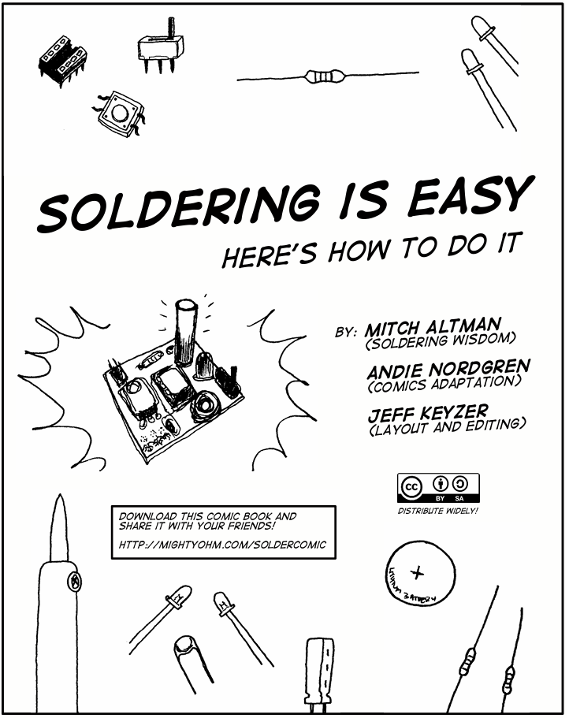

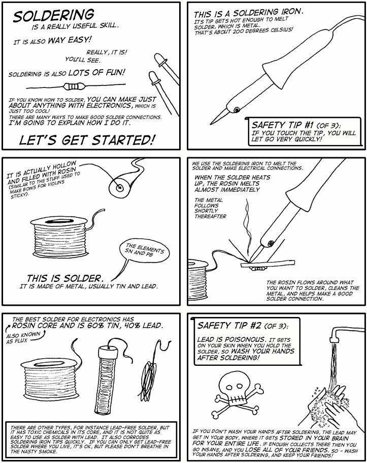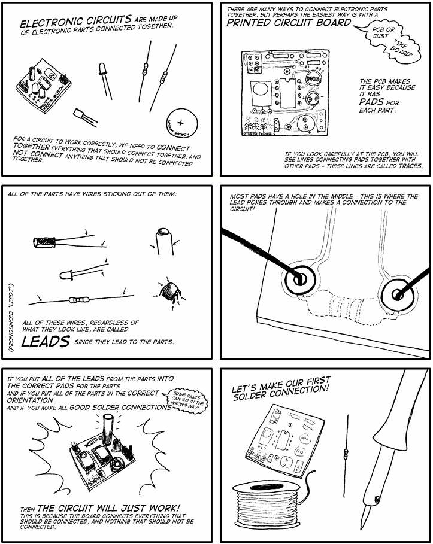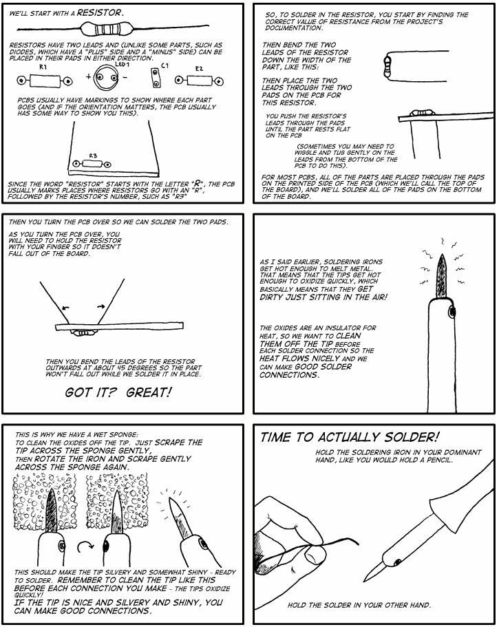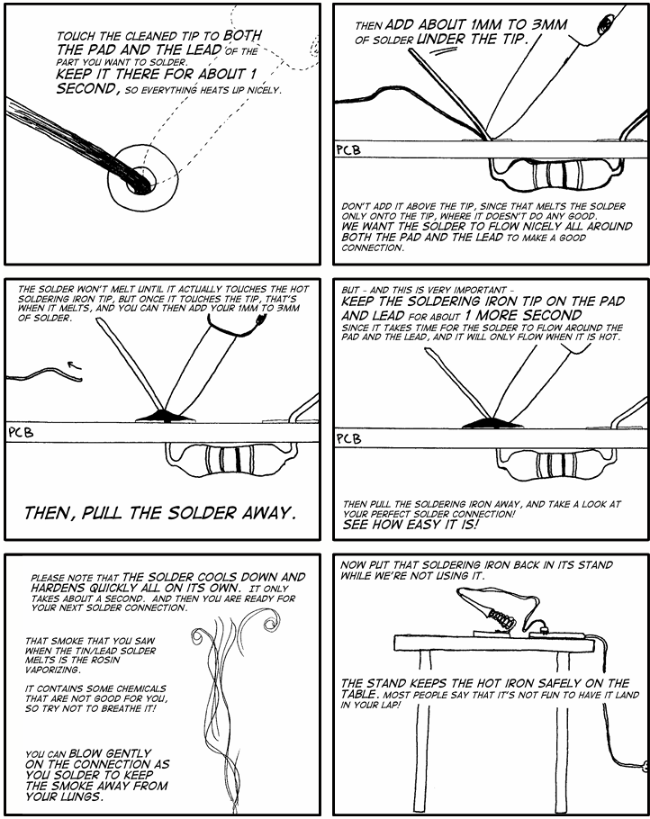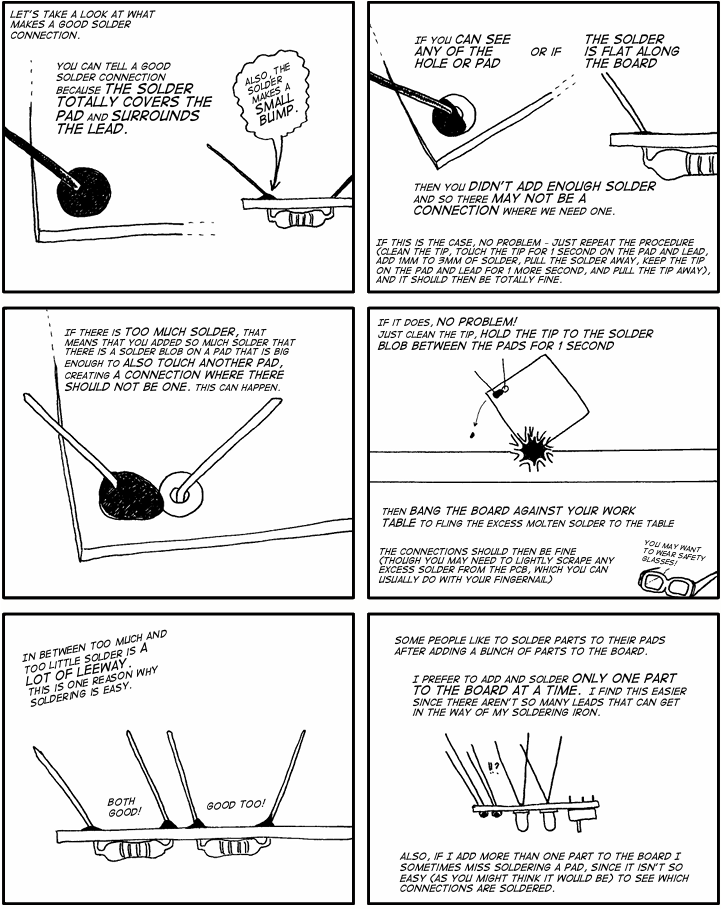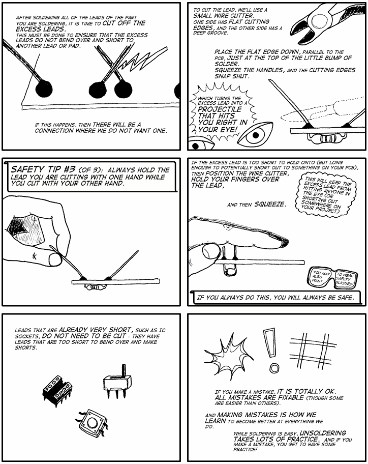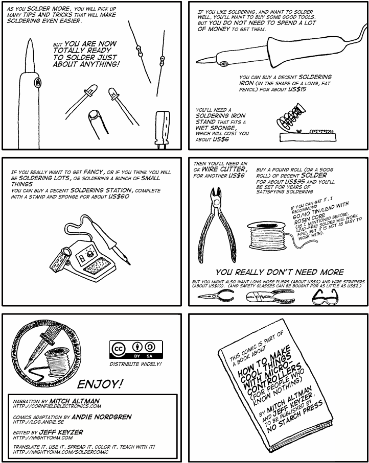

## Using this booklet

This booklet is written for Scouts and Explorers aged approximately 10 to 16. It introduces beginner electronics in small steps and is designed to be used with an adult Leader. Ask for help whenever you are unsure, especially when using a soldering iron, drill, sharp cutters, batteries, or a multimeter.

The activities in this booklet are intended for low-voltage battery circuits only. Do not connect a project to mains electricity, a wall socket, a vehicle battery, or any unknown power supply. A Leader should check each circuit before power is applied.

### Badge requirements at a glance

Requirement 1 — Components and functions: use the Component Types, Basic Electronics Theory, and Circuit Projects sections.

Requirement 2 — Markings and ratings: use The Colour Code of Resistors, capacitor markings, and the Ratings and datasheets section below.

Requirement 3 — Symbols, diode polarity, and IC pin numbers: use Schematic Diagrams and the Pin identification section below.

Requirement 4 — Safe working: read Safety First before handling parts, circuit boards, tools, batteries, or soldering equipment.

Requirement 5 — Multimeter measurements: complete the Using a Multimeter activity with a Leader.

Requirement 6 — Analogue and digital circuits: compare the examples in Analogue and Digital Electronics.

Requirements 7 to 9 — Three circuits, operation, typical values, and uses: complete the three Circuit Projects and record your results.

Requirement 10 — Uses and benefits: discuss the Everyday Uses of Electronics section and give examples of how electronics can improve people’s lives.

## Safety First

Work only under the supervision of a Leader. Use a tidy, well-lit work area with a heat-resistant surface. Keep drinks, food, loose paper, and flammable materials away from the workbench. Tie back long hair and avoid loose sleeves or jewellery.

Disconnect the battery or power supply before changing wiring. Never assume a circuit is unpowered: check it with a voltage measurement when a Leader says it is appropriate. Do not place a multimeter set to current directly across a battery or power supply.

Wear eye protection when cutting component leads or drilling. Hold small parts with clips or pliers rather than your fingers. Keep the soldering iron in its stand when it is not in use, never touch the metal tip, and allow parts and the board to cool before handling them.

Use lead-free solder unless a Leader has approved another type. Wash your hands after soldering and before eating. Keep solder and clipped wire ends away from mouths, eyes, and younger children. Use suitable fume extraction or good ventilation and keep your face out of the smoke or flux fumes.

Never deliberately overload or heat a resistor to see what happens; it can become hot enough to burn skin or damage nearby materials. Before connecting power, check the polarity of LEDs and electrolytic capacitors against the component markings and circuit diagram. A reversed LED may not light and could be damaged if its reverse-voltage rating is exceeded. A reversed electrolytic capacitor can overheat and fail, and may vent gas or electrolyte. Ask your Leader to check any part whose direction is unclear.

If a component, wire, battery, or tool becomes hot, smells unusual, smokes, or behaves unexpectedly, disconnect the power if safe to do so and tell a Leader immediately. Never continue troubleshooting a powered circuit by touching random points.

## Ratings and datasheets

A component rating tells you the limits within which it is designed to work. Check resistance in ohms, capacitance in farads, voltage rating, current rating, power rating, polarity, and temperature limits where relevant. A component with a higher voltage or power rating is not automatically a suitable replacement: the value, package, pinout, and function must also match.

For a resistor, the power rating is the maximum heat it can normally dissipate. For a capacitor, never exceed its voltage rating and observe polarity for polarised types such as electrolytic capacitors. For a diode or LED, check both its polarity and its allowed forward current. For an integrated circuit, check the supply-voltage range and the pinout in the manufacturer’s datasheet.

## Using a Multimeter

A digital multimeter (DMM) combines several measuring functions in one tool. A basic DMM can measure voltage, current, resistance, and continuity; other functions vary by model. The display shows the reading, the selector chooses the measurement function and range, and the probes connect to sockets marked for common (COM), voltage/resistance, and current. Socket layouts and markings vary, so check the meter’s instructions rather than relying on where a socket is positioned.

Before measuring, check the meter and leads for damage, identify what you are measuring, and select the correct function and range. Black normally goes to COM. The red lead goes to the voltage/resistance socket for voltage and resistance measurements, and to the current socket only when measuring current. Ask a Leader to check the lead positions before connecting the meter. For the battery circuits in this booklet, select DC voltage, usually marked `VDC` or `V⎓`. AC voltage uses a different setting; do not use it for a battery.

If your meter is auto-ranging, select DC voltage and let it choose the range. If it has manual ranges, choose one above the voltage you expect to measure. If you are unsure, start at a higher range and step down, following the meter’s instructions. For example, a 20 V range can measure a 9 V battery if your meter has that range. Place the probes across the battery or component: red on one side and black on the other. The reading is the voltage at the red probe compared with the black probe. On a simple battery circuit, put black on the negative side and red on the positive side; swapping them normally gives the same reading with a minus sign. Keep the metal probe tips from touching each other or bridging nearby contacts.

### Measuring DC current

Only measure current in a battery circuit approved by your Leader, with your Leader supervising. Switch off the supply before changing the circuit or meter connections. Put the red lead in the current socket specified by the meter’s instructions, and select DC current (`A⎓` or `mA`). Check that the expected current is below the limits for that socket, range, and fuse. If your meter has manual ranges, choose one above the expected current; start higher if you are unsure.

To measure current, break the circuit and put the meter in series so the circuit current passes through it. For conventional current flowing from the battery’s positive side towards its negative side, connect the red probe towards the positive side and the black probe towards the negative side. Ask your Leader to check the setup before switching the supply on. Never put a meter set to current directly across a battery or supply: its current input has low resistance, so this can create a short circuit and blow the meter’s fuse or damage it. When the reading is complete, switch off the supply before disconnecting the meter. Move the red lead back to the voltage/resistance socket and switch the meter off or back to voltage mode.

To measure resistance or continuity, switch the circuit off and make sure any capacitors are discharged. Where possible, disconnect one end of the resistor so that other components do not affect the reading.

Voltage is the electrical potential difference that can drive charge. Current is the rate of charge flow. Resistance opposes current. In a simple resistive circuit, Ohm’s law is V = I &#215; R. Power is P = V &#215; I. Record the units: volts (V), amperes (A), ohms (Ω), and watts (W).

### Quick check: using a multimeter

**Question 1 of 3**

What happens if you swap the two DMM probes when measuring DC voltage?

- The voltage reading changes sign (it is negated).
- The DMM will break.
- The measurement will be out of range.
- The DMM will display the number 1.

**Answer for the Leader:** The voltage reading changes sign. The meter shows the red probe’s voltage relative to the black probe, so swapping them reverses the sign but normally leaves the magnitude unchanged.

**Question 2 of 3**

What is **not** a basic type of DMM measurement?

- Resistance
- Magnetism
- Voltage

**Answer for the Leader:** Magnetism. A basic DMM measures electrical quantities such as voltage, current, resistance, and continuity.

**Question 3 of 3**

If you try to measure voltage while your DMM is set to `_____` mode, it can blow the fuse.

- Current
- Electrical continuity
- Voltage
- Resistance

**Answer for the Leader:** Current. A meter in current mode has a low-resistance path. Connecting it across a battery or supply can cause a short circuit. Too much current can blow the meter’s fuse: the fuse is a safety part that melts and opens the circuit to help protect the meter. If it blows, the current-measurement function may stop working. Ask a Leader to check the meter and its instructions; the fuse does not prevent every kind of damage.

## Analogue and Digital Electronics

Analogue circuits use continuously varying voltages or currents. A microphone signal, a light sensor, and a temperature sensor are examples. Digital circuits use defined logic states, commonly described as LOW and HIGH or 0 and 1. Real digital signals still have voltage ranges, noise margins, timing limits, and current limits.

A sensor circuit may begin as analogue and then use a comparator or digital input to make a decision. This is why many real products combine analogue and digital electronics.

## Pin Identification

For a diode or LED, look for the manufacturer’s polarity marking. A diode often has a band at the cathode end. An LED usually has a longer lead for the anode when new, a shorter lead for the cathode, and a flat edge or internal shape that may also indicate the cathode. Always confirm with the symbol or datasheet because leads may have been trimmed.

For an integrated circuit, find the notch, dot, or other pin-1 mark. With the notch at the top, pin 1 is normally the first pin to the left and the numbers continue around the package. Do not rely on appearance alone: check the exact package datasheet.

## Circuit Projects

### Project 1 — LED and resistor indicator

Purpose: learn polarity, current limiting, voltage measurement, and Ohm’s law. Use a battery pack or regulated supply approved by your Leader, one bare LED, and a suitable series resistor. A bare LED needs current limiting; never connect it directly across the supply. The resistor limits the current. Typical beginner values are a few volts of supply and a few milliamperes of LED current; calculate the resistor with R = (supply voltage − LED forward voltage) &#247; desired current.

Worked example: suppose the supply is 9 V, the LED’s forward voltage is about 2 V at the chosen current, and the target current is 15 mA (0.015 A). The resistor has about 9 V − 2 V = 7 V across it. Use this resistor voltage—not the full 9 V supply voltage—to calculate its value: R = 7 V &#247; 0.015 A = about 467 Ω. Choose 470 Ω, a common standard value just above the calculated value. In a series circuit, the same current flows through the LED and resistor, so the estimated current is 7 V &#247; 470 Ω, or about 15 mA. The LED is non-ohmic, so do not try to calculate its behaviour as if it were a fixed resistor; use its forward voltage from the datasheet at the intended current. These are example values, not specifications for every LED: check the LED datasheet and actual supply voltage before choosing a resistor. The resistor dissipates about 0.10 W, so select a power rating with suitable margin for its operating conditions.

If the LED does not light, switch off or disconnect the supply before checking the wiring and LED polarity. Turning the LED around may correct a reversed connection. Do not leave the circuit powered while changing connections.

Operation and use: when the circuit is complete, current flows through the resistor and LED, producing light. Possible uses include a power indicator, a status lamp, or a warning that a switch is on. Measure the supply voltage and the voltage across the LED, then measure the circuit current in series.

### Project 2 — Light-sensitive alarm

Purpose: learn about sensors and control. Use an LDR or phototransistor, a transistor or suitable comparator module, a resistor network, and a low-voltage buzzer. The sensor changes the control voltage when the light level changes; the transistor or comparator then switches the buzzer. Use a ready-made module or a Leader-checked schematic if the exact transistor or comparator pinout is unfamiliar.

Operation and use: the circuit can detect light, shade, an open drawer, or a change in room brightness. Record the supply voltage, the approximate buzzer current, and the sensor voltage in bright and dark conditions.

### Project 3 — Digital two-input decision circuit

Purpose: meet the digital-circuit requirement by using a logic-gate IC such as a 74HC08 AND gate or another Leader-approved 5 V logic device. Use two push-buttons as inputs, pull-down or pull-up resistors so that the inputs never float, and an LED with a series resistor as the output indicator. Follow the exact IC pinout and supply-voltage limits in the datasheet.

Operation and use: an AND gate produces a HIGH output only when both inputs are HIGH. The circuit can be used for two-button consent controls, a simple safety interlock demonstration, or a game requiring two players to press buttons together. Record the logic input states, output state, supply voltage, and LED current.

### Project record

For each circuit, record: the circuit name; a hand-drawn schematic using standard symbols; the supply voltage; at least one measured current; at least one measured voltage; the purpose of each component; what happens when an input changes; one possible real-world use; and one safety check completed before power was applied.

## Everyday Uses of Electronics

Electronics is used in communication, healthcare, transport, homes, energy systems, environmental monitoring, accessibility devices, education, and emergency services. Examples include hearing aids, insulin pumps, traffic signals, navigation systems, smoke alarms, renewable-energy controllers, phones, computers, and assistive switches. Discuss both the benefits and the responsibilities: reliable design, privacy, repairability, energy use, recycling, and safe disposal of batteries and electronic waste.

## What to try next

Learning to solder gives you a way to build and repair electronic projects. If you enjoyed this activity, choose a next step that interests you:

- Build a kit or make a simple robot. Ask your Leader to check that the kit and parts suit your experience.
- Try coding with an Arduino or Raspberry Pi. A program can read a sensor and control an LED, buzzer, or motor. Start with a low-voltage project and follow the board’s instructions.
- Explore a circuit idea in the [Falstad Circuit Simulator](https://www.falstad.com/circuit/) before building it. A simulation helps you explore how a circuit may behave; check the real circuit carefully as well.
- Learn to draw schematics and design circuit boards with [KiCad](https://www.kicad.org/). You can study open-source designs, but check their licence before reusing them. See [Finding a board to practise on](Scouts%20Electronics%20Activity%20Badge%20Booklet.md#finding-a-board-to-practise-on).
- Find out what electronics jobs involve. Ask your Leader whether you can talk to someone who designs, builds, tests, or repairs electronic equipment; there are different routes into this work.
- Practise repairing low-voltage projects with an adult. Do not open or repair mains-powered appliances as a beginner activity.

You do not need to do all of these. Pick a project, get help when you need it, and keep experimenting safely.

## Further reading

### Surface-mount soldering (optional)

The Woggle PCB supplied with this booklet uses through-hole components. You do not need surface-mount soldering to build it. This section introduces a different technique for anyone who wants to learn more.

Surface-mount components sit on copper pads on the board instead of having leads that pass through holes. Some packages are too small to solder easily by hand, but many larger ones can be soldered with an iron. See [Adafruit’s guide to surface-mount soldering](https://learn.adafruit.com/adafruit-guide-excellent-soldering/surface-mount?view=all).

Most of the time, I hand-solder surface-mount components in 0805 packages. Sometimes I work with 0604 parts. I can solder smaller parts too, but I find them hard work. These numbers are package-size codes, not component values.

For ICs, a SOIC package with 1.27 mm pin pitch (the distance between adjacent pins) is about my preferred limit for hand-soldering. I can manage finer-pitch packages, but find them hard work.

Before soldering, inspect the board and pads. Dirt, grease, or oxidation can stop solder from wetting a pad. Do not clean every board automatically: if a board looks dirty, ask your Leader whether it needs cleaning and which method is suitable. Follow the cleaning instructions in [Clean flux residue from a circuit board](Scouts%20Electronics%20Activity%20Badge%20Booklet.md#clean-flux-residue-from-a-circuit-board), and make sure the board is completely dry before soldering.

Choose solder wire and an iron tip that suit the size of the pads. The 0.6 mm wire in the range described above can make it easier to feed a small amount onto a small pad. The iron tip must reach the pad without touching neighbouring pads, while still transferring enough heat to the joint. Ask your Leader to help choose a suitable tip; see [HAKKO’s soldering-tip guidance](https://www.hakko.com/english/support/maintenance/detail.php?seq=171).

For hand-soldering SMDs, I consider a flux pen essential. It lets me apply a small amount of electronics flux exactly where it is needed and helps solder wet the pads. Follow the pen’s instructions and clean any residue as directed.

I also have a temperature-controlled hot-air rework station and a small hot plate on my bench. Hot air and a hot plate are other ways to work with surface-mount parts, but they heat a wider area than an iron and need their own techniques. Use them only with your Leader, and follow the tool, solder, and component instructions. Never use IPA or another flammable cleaner near a hot iron, hot-air station, or hot plate.

#### Soldering a small surface-mount part

Practise on a separate SMD practice board, not the through-hole Woggle PCB. Start with a larger part, such as an 0805 resistor. Resistors are not polarised, but check the part value and board layout before fitting one.

1. With your Leader supervising, secure the unpowered board in a holder. Apply a little flux from your flux pen to the pads.
2. Clean the iron tip and put a small amount of solder on one pad.
3. Hold the part with tweezers and line it up with the pads. Reheat the tinned pad to tack one end of the part in place. Let it cool and check the alignment.
4. Solder the other end. Feed a small amount of solder to the heated pad and component terminal; use only enough to make the joint.
5. Inspect both ends with magnification. If needed, ask your Leader to help reflow the first end. Check the project instructions for any parts with polarity before soldering.

#### Soldering a multi-pin surface-mount IC

Before fitting an IC, check its pin 1 mark and match it to the board layout. Apply flux to the pads, line up the pins, then tack one corner pin. Check the alignment and tack a pin at the opposite corner before soldering the remaining pins.

I do not like drag soldering; I prefer to feed solder to one pin at a time. With flux on the pins and pads, heat one pin and its pad together, then feed a small amount of solder to the joint. Work along each row and inspect under magnification as you go. Use an iron tip suited to the pin spacing. Too much solder can bridge neighbouring pins. If that happens, stop and ask your Leader to show you how to remove the excess with flux and solder wick. Do not scrape or pull the wick across the board; it can damage the pads. See [HAKKO’s guidance on soldering-tip shapes](https://www.hakko.com/english/support/maintenance/detail.php?seq=171) and [using solder wick](https://www.hakko.com/english/products/hakko_wick_2_feature.html).

#### Correcting excess solder on surface-mount joints

Too much solder can bridge nearby pins and cause a short circuit. If you see a bridge, stop and ask your Leader to check it. The board must be disconnected from power before any repair.

With your Leader supervising, apply a small amount of electronics flux to the bridge. Lay fresh solder braid over the excess solder, then gently heat the braid with the iron until solder flows into it. Lift the braid and iron away together; do not drag or scrape the braid across the pads, as this can damage them. Use a fresh piece of braid if needed, and let the braid and board cool before touching them. For one small bridge, your Leader may choose to reflow the joint with flux and a clean iron tip instead.

Inspect the pins under magnification afterwards. Check that the bridge is gone and each pin still has a sound joint to its pad. If a joint needs more solder, feed a small amount to that pin only. Do not use drag soldering to add solder. Do not power the board until your Leader has checked the component orientation and solder joints.

#### Applying solder paste with a stencil

Stencil printing is another way to solder surface-mount parts. A stencil places solder paste onto many board pads at once. Components are then placed on the paste and soldered in a separate heating step called *reflow*. This is an advanced process and needs direct Leader supervision.

Solder paste contains tiny metal particles and flux. Different pastes can have different alloys and handling requirements. Read the exact product’s label, safety data sheet, and instructions. Avoid skin and eye contact, keep food and drink away, and wash your hands after handling. The storage temperature and shelf life depend on the paste. Follow its instructions; if it must be refrigerated, let it warm to room temperature naturally before opening it. Do not heat it to warm it up. See [Kester’s solder-paste handling guidance](https://www.kester.com/Portals/0/Documents/Knowledge%20Base/Kester-Solder-Paste-Handling-Guidelines-Solder-Paste-Americas-EN-24Jun21-RB.pdf).

To apply the paste, secure the board in a stencil holder and line up the stencil openings with the board pads. Use a suitable squeegee to spread a small bead of paste evenly across the stencil. Lift the stencil straight up, then check that paste has been left on the pads without smearing between them. Stop and ask your Leader if the stencil has moved or the paste has spread across neighbouring pads. Thin metal stencils can have sharp edges, so let your Leader handle them.

Use tweezers to place each component on its paste deposits. Check the board layout and component markings for polarity and pin 1 before placing parts. Reflow is a separate step: do not heat the board until your Leader has checked the component placement and selected a process that matches the paste, board, and components. Follow the hot-air station or hot-plate instructions and use a heat-resistant work surface. For more information, see [AIM Solder’s handling guidance](https://www.aimsolder.com/technical-center/solder-paste-handling-tips/).

#### Reflow solder paste with hot air

A hot-air rework station can heat the solder paste until it melts and joins the components to the board. On my bench, I use a 400 °C setpoint on both my soldering iron and hot-air station. The suitable temperature and airflow still depend on the station, solder paste, board, and components, so my setting is not a recipe for another setup. A trained adult should choose the heating process, use fume extraction, and secure the board on a heat-resistant surface.

Before heating, check the position and orientation of every component. Warm the board gradually and move the hot-air nozzle around the area so the heat is spread evenly. Use only enough airflow to avoid moving the small parts. Watch the solder; once it has flowed onto the pads and component leads, stop heating and let the board cool without moving it. The nozzle, air, and board will be very hot, so keep hands clear. After cooling, inspect the joints and check that no components have shifted or been fitted the wrong way round. Do not power the board until your Leader has checked it.

#### Removing a surface-mount IC (advanced)

Removing a surface-mount IC is an advanced repair task and is not needed for the Woggle project. It should be done by an experienced Leader. Hot-air rework is the preferred method when removal is necessary. Secure the unpowered board, use fume extraction, and follow the station, board, and component instructions. Heat around the IC so all its pins reflow. Do not pull or pry the IC: when all the solder has melted, it should lift away with tweezers. If it resists, stop and ask the Leader to check whether more heating is needed.

After the board cools, the Leader can remove excess solder from the pads with flux and solder braid, using the method above. Inspect the pads and tracks for damage before fitting another component. Reusing a removed IC is not guaranteed; heat can damage the component or board.

Cutting the leads of an IC is a destructive last resort, only for a part that will be discarded. It can damage the PCB, and clipped leads can fly away. A Leader must decide whether it is suitable and use eye protection. Do not try this as a beginner repair.

### Quick check: surface-mount soldering (optional)

**Question 1 of 4**

What diameter of solder wire is a suitable choice for hand-soldering small surface-mount parts?

- 2.2 mm
- 3.4 mm
- 0.8 mm or smaller
- 1–1.8 mm

**Answer for the Leader:** 0.8 mm or smaller. Fine solder wire can make it easier to control how much solder you add to small pads.

**Question 2 of 4**

If a bare PCB needs cleaning before soldering, which cleaner may be suitable?

- Peroxide
- Isopropyl alcohol
- Water
- Bleach

**Answer for the Leader:** Isopropyl alcohol may be suitable for cleaning a bare PCB. Check the board and cleaner instructions first, keep the flammable alcohol away from heat or flames, and let the board dry completely before soldering.

**Question 3 of 4**

When using hot air to reflow surface-mount solder paste, how should you move the nozzle?

- Use extra heat to melt the solder quickly.
- Move it slowly in circles while warming the board gradually.
- Apply heat quickly so the solder melts fast.
- Put the hot-air nozzle against the component.

**Answer for the Leader:** Move the nozzle slowly around the area while warming the board gradually. This helps spread the heat; the right process still depends on the solder paste, board, components, and station.

**Question 4 of 4**

If the solder paste maker specifies refrigerated storage, where should it be kept?

- In a small heated enclosure
- On your workbench
- In a clearly labelled, non-food refrigerator

**Answer for the Leader:** In a clearly labelled, non-food refrigerator. Storage requirements vary, so follow the paste maker’s instructions. If the paste needs refrigeration, let it reach room temperature naturally before opening it, as the instructions direct.
